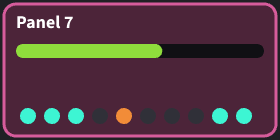

<p align="center">
  
</p>

<h1 align="center">v-snap</h1>

<p align="center">
  <strong>Visual tests as fast and as dependable as unit tests.</strong><br>
  For views drawn with Pixi, three.js, any canvas, or HTML.
</p>

<p align="center">
  
  
  
  
  
</p>

[Visual snapshot tests](docs/writing-tests.md) have two
well-known problems: they're slow, and they're flaky. Most tools take a
screenshot of the page for each image, and that's slow. And each system
draws a little differently, so a reference image made on one machine can
fail on another. The usual cure for the flakiness is to draw every image
in Docker, so that every machine draws alike. But then every developer
and every CI job must run Docker, and the slow tests get slower. So many
projects fall back on fragile
[assertions](https://yortus.com/mvt-games/docs/building-with-mvt/iterating-with-confidence/testing-views.html#scene-graph-assertions)
about their views, or skip view testing altogether.

v-snap is fast, and it draws the same images on every machine, without
Docker.

- **It's an order of magnitude faster per image.** A canvas image takes
  about 4 ms to draw and check. A screenshot test in the same browser
  takes 67 ms. 1000 images run in under 8 seconds, start-up included.
- **Every machine draws the same images.** A reference made on Windows
  passes on Linux and macOS, and the other way round. v-snap is checked on
  Windows x64, Linux x64 and arm64, and macOS arm64. `npm ci` installs
  everything but the browser, and the first run downloads that.

And it fits the way you already test.

- **Its tests are Vitest tests.** One plugin adds them to your Vitest
  config, and `vitest` runs them with your unit tests. Watch mode, the
  Vitest UI and the VS Code extension all work.
- **One line declares one image.** You don't need to build a test page.
- **It draws Pixi and three.js views itself,** and any canvas that your
  test draws. It tests HTML views too, and you can add support for other
  renderers.

## Adding Visual Tests

By default, each test file goes in a `visual-tests` folder beside the view
that it tests (but you can configure it however you like). Each test has a
name and a pose. A pose is the function in each test that builds the view,
in the state that the test describes, and returns it.

```tsx
// src/hud/visual-tests/hud-view.test.tsx
import { canvasTest } from 'v-snap';
import { HudView } from '../hud-view';

canvasTest('at the start', () => HudView({ score: () => 0 }));
canvasTest('a high score', () => HudView({ score: () => 98_765 }));
```

The first run writes each test's image as its reference image, beside the
test file. Here, they're `hud-view.at-the-start.png` and
`hud-view.a-high-score.png`. Look at them, and commit them. From then on,
each run compares each test's new image with its reference.

## When an Image Changes

When a view draws differently, its test fails. v-snap writes the actual
image, which is what the view drew this time. It also writes a diff, which
shows the reference dimmed and the changed pixels in red. Here, one more
light is on:

| The reference | The actual image | The diff |
| :---: | :---: | :---: |
|  |  |  |

The failure message says where the image changed, and by how much:

```
Image 'a-panel' differs from its reference in 214 pixels, by up to 194 of 255,
in the 16x16 pixels at (116, 108).
```

Then it names the three files. If you meant the change, the message ends
with a command that makes this one image the new reference. The Vitest UI
shows the same three images, with a slider that lets you compare the
reference and the actual image.

## How Much Faster is v-snap?

Here are the times for the same 1000 images of Pixi views, checked with
v-snap and with Vitest's own `toMatchScreenshot`, in the same browser:

| | 1000 images, start-up included | One image, at the median |
| --- | ---: | ---: |
| **vitest** `toMatchScreenshot`, one file at a time | 89.9 s | 67 ms |
| **vitest** `toMatchScreenshot`, 13 files at once | 18.0 s | 131 ms |
| **v-snap**, in one page | **7.8 s** | **4.0 ms** |

Per image, **v-snap is up to 33x faster**. By default, Vitest runs several
test files at once, one for each processor core but one. That makes vitest's
whole run faster, but each screenshot slower. Even against 13 files at
once, v-snap was still 2.3 times as fast. [The benchmark](docs/how-it-works.md#the-benchmark) says how it was measured, and how you can run it yourself.

## Limitations a Project Must Accept When Using v-snap

v-snap draws the same images everywhere because it decides how they're
drawn. That has some costs, and [Limits and Rules](docs/limits-and-rules.md)
lists them in full.

- **Canvas text is drawn in v-snap's own fonts,** Source Sans 3 and Source
  Code Pro. Text that a view measures is measured in them too. A character
  that they lack, such as an emoji, is drawn as a box.
- **HTML text is drawn blank.** Every letter is an empty space 0.625 em
  wide. So an HTML image shows layout and styling, but not words. Text
  wraps where it would if every letter were that wide.
- **Drawing is done in software.** WebGL runs on the processor, not on the
  graphics card. So the tests can't catch something that only a graphics
  card draws differently.
- **Each release of v-snap supports one minor version of Playwright.**
  Every machine must draw with the same build of Chromium, and Playwright
  moves to a new build in each minor version. So you upgrade Playwright
  when v-snap does.
  [Playwright Versions](docs/getting-started.md#playwright-versions)
  explains why.

## Quick Start

1. Install v-snap beside Vitest. npm also installs Playwright, and
   Vitest's Playwright provider, because v-snap needs them.

   ```sh
   npm install --save-dev v-snap vitest
   ```

2. Add the `vsnap()` plugin to `vitest.config.ts`. When Vitest starts, the
   plugin adds v-snap's projects, which run the visual tests. It also
   leaves the visual tests out of your unit tests, which keep their
   settings.

   ```ts
   import { defineConfig } from 'vitest/config';
   import { vsnap } from 'v-snap/vitest';

   export default defineConfig({
       plugins: [vsnap()],
       test: {
           // The unit tests' settings, as before.
       },
   });
   ```

3. Create `vsnap.config.ts` beside it, and add the file to
   `tsconfig.json`'s `include`. It lists the kinds of view that your tests
   pose. A kind of view tells v-snap how to recognise a view, such as a
   Pixi container, and how to draw it.

   ```ts
   import { defineVsnapConfig } from 'v-snap';
   import { pixiViews } from 'v-snap/pixi';

   const config = defineVsnapConfig({
       views: [pixiViews()],
       defaultKind: 'pixi',
   });

   // Tells TypeScript about the kinds of view above, so that canvasTest
   // accepts tests of those kinds and checks their options. It also lets a
   // test leave out its kind, to use the default kind.
   declare module 'v-snap' {
       interface Register {
           config: typeof config;
       }
   }

   export default config;
   ```

4. Add `.vitest/` to `.gitignore`. That's where v-snap writes a failed
   test's images, for you to look at, and they don't belong in the
   repository.

5. Write a test, as above, and run `npx vitest`.

[Getting Started](docs/getting-started.md) says what you need, and how to
add v-snap to a config that already has settings or projects.

## Documentation

- **[Getting Started](docs/getting-started.md)** covers the requirements,
  Playwright versions, adding v-snap to a project, and your first test.
- **[Writing Tests](docs/writing-tests.md)** covers declaring tests, views
  that change over time, shared setup, options, how HTML views are
  captured, and image names.
- **[Kinds of View](docs/kinds-of-view.md)** covers Pixi, three.js,
  canvases and HTML, the options of each, preparing and disposing of
  views, configs in a monorepo, and support for another renderer.
- **[Configuration](docs/configuration.md)** covers adding v-snap's
  projects, their options, and where test files and references go.
- **[Running the Tests](docs/running-tests.md)** covers the commands, the
  checks of the references, reviewing a failed image, CI and watch mode.
- **[How It Works](docs/how-it-works.md)** explains what makes v-snap
  fast, how the benchmark works, and how every machine draws the same
  images.
- **[Limits and Rules](docs/limits-and-rules.md)** lists what the images
  leave out, and the rules that your tests follow.
- **[Troubleshooting](docs/troubleshooting.md)** lists v-snap's messages,
  and what they usually mean.

## API

The package is named `v-snap`. A name in code can't contain a hyphen, so
in code it's `vsnap`, as in `vsnap()`, `defineVsnapConfig` and
`vsnap.config.ts`.

| Import | Export | What it does |
| --- | --- | --- |
| `v-snap` | `canvasTest(name, options?, pose)` | Declares a test of a view drawn on a canvas. It has Vitest's modifiers, such as `.skip`, `.only` and `.each` |
| | `htmlTest(name, options?, pose)` | Declares a test of an HTML view, with the same modifiers |
| | `defineVsnapConfig(config)` | Returns the config unchanged, with each kind's name kept in its type, so that the `Register` declaration can pass it to `canvasTest`'s types |
| | `bindCanvasTest(config)` | Returns a `canvasTest` tied to one config's kinds of view, for when each package of a monorepo has its own config |
| | `htmlViews(options?)` | Returns the kind of view for HTML, with optional steps to prepare and dispose of each view, and a background for every test |
| | `fitImage`, `readCanvas` | Help you support another renderer. `fitImage` returns how an image fits the size budget, which is the most pixels an image may have. `readCanvas` returns a canvas's pixels |
| `v-snap/vitest` | `vsnap(options?)` | Returns a Vitest plugin. When Vitest starts, it adds v-snap's projects, which run the visual tests, and leaves the visual test files out of your other tests |
| | `vsnapProjects(options?)` | Returns v-snap's Vitest projects, for a config that lists its projects itself |
| `v-snap/pixi` | `pixiViews(options?)` | Returns the kind of view for Pixi |
| | `getPixiRenderer()` | Returns a promise of the Pixi renderer that draws the images, for a view that needs one to build itself |
| `v-snap/three` | `threeViews(options?)` | Returns the kind of view for three.js |

## Requirements

| Needs | Version |
| --- | --- |
| Vitest, with `@vitest/browser-playwright` | 5 |
| Playwright, installed with v-snap | 1.64, any patch release |
| Node | 22.17 or later |
| Pixi, for Pixi views | 8.16 or later |
| three.js, for three.js views | 0.160 or later |

A canvas test can draw with the browser's own canvas, so it needs no
renderer library. [Getting Started](docs/getting-started.md#requirements)
says why you need each of the others.

## Contributing

To work on v-snap itself, see [CONTRIBUTING.md](./CONTRIBUTING.md). It
explains how v-snap's own tests run, how the package is laid out, how the
test environment is checked and upgraded, and how the package is built
and published.

## Licence

v-snap is under the MIT licence. v-snap's own fonts, Source Sans 3 and
Source Code Pro, are under the SIL Open Font License. The published
package holds the fonts in `lib/browser/fonts/`, and their licences in
`src/browser/fonts/`.
