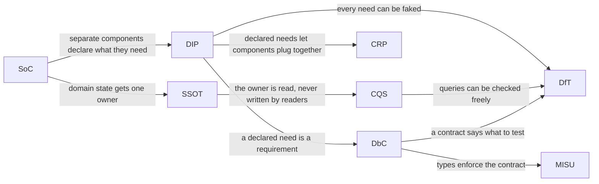

# The Principles Behind MVT

> MVT's rules were not invented from scratch. Each one follows from a small
> set of well-known design principles, and this section explains them: eight
> principles, one page each, all serving one goal. Read them to understand
> why the rules are what they are, and to decide the cases no rule covers.

**Related:** [Architecture Overview](../index.md) ·
[Rules](../rules.md) ·
[Heritage](../heritage.md)

---

## Why Principles, Not Just Rules

The [rules](../rules.md) say what an MVT program must do: a
[model](../../reference/glossary.md) advances only through `update(deltaMs)`,
a [view](../../reference/glossary.md) holds no domain state, and so on. Rules
are quick to check, and most of the time they are all you need.

Sooner or later, though, you meet a case no rule mentions. An audio view. A
view that needs to know the player was just hit. A model that two games
want to share. A rule can't help there, because it was written before
anyone thought of the case. What helps is knowing *why* the rules exist,
because the same reasons apply to the new case.

That is what a principle is: the reasoning behind a group of rules, stated
generally enough to apply to cases the rules never anticipated. The
principles in this section are not new, and none of them is specific to
games. Most have decades of use behind them, and each has a name you can
search for.
MVT is what you get when you apply all eight, together, to a program that
runs in frames.

## The Goal

Every principle here serves one goal:

> **Any component of a game can be understood and tested alone, and changed
> or replaced without changing anything else.**

This is easiest to see from its opposite. In a tangled program, a change
ripples: renaming a field breaks a view, the fix to the view changes what
its parent passes in, and that changes what a test expects. Each step is
small, but nobody can say in advance where the ripple stops, so every change
costs more than it should and is riskier than it looks.

The goal is for the ripple to stop at the edge of the component you
changed. The rest of the game doesn't need to know the change happened:
nothing else needs editing, and nothing else needs checking again. Each
principle below is one way of stopping the ripple.

A [component](../../reference/glossary.md), here and on every principle
page, is any separable unit of an MVT program: a model, a view, the ticker.
Where that could be unclear, the pages say *MVT component*, or name the
kind.

## The Eight Principles

They are best read in this order, since each builds on the ones before it.

| # | Principle | In one line | The question it asks |
| --- | --- | --- | --- |
| 1 | [Separation of Concerns (SoC)](separation-of-concerns.md) | Domain state, presentation and time are separate concerns, with separate owners: the model, the view and the ticker | Which concern does this belong to? |
| 2 | [Single Source of Truth (SSOT)](single-source-of-truth.md) | Each piece of domain state lives in one place; everything else reads it or derives it | Where does this value really live? |
| 3 | [Command-Query Separation (CQS)](command-query-separation.md) | Reading state never changes it: each tick runs every command, then every query | Does this read change anything? |
| 4 | [Dependency Inversion Principle (DIP)](dependency-inversion.md) | A component declares what it needs, as a small interface, and is given it, time included | Is this component reaching for something it should be given? |
| 5 | [Composite Reuse Principle (CRP)](composite-reuse.md) | Build bigger things by combining smaller ones, never by extending them | Can this be built from components that already exist? |
| 6 | [Design by Contract (DbC)](design-by-contract.md) | Every component states what it requires and what it guarantees, and fails loudly when a requirement is not met or a guarantee cannot be kept | What does this need, and what exactly does it promise? |
| 7 | [Make Illegal States Unrepresentable (MISU)](illegal-states-unrepresentable.md) | Design state and types so that illegal states cannot even be written | Can this be set to an illegal state? |
| 8 | [Design for Testability (DfT)](design-for-testability.md) | Every component can be tested on its own, through its contract, with the same result every time | How would I test this, with nothing real around it? |

## How They Build on One Another

The principles are not a checklist of separate ideas. Each one makes the
next possible, or makes it pay off.

Read as a story:

1. **Separate the concerns** (SoC), and domain state ends up in models.
2. **Give each piece of it one home** (SSOT), so nothing can disagree with it.
3. **Read it without changing it** (CQS), so every reader sees the same
   thing, in any order. This is how the goal holds in a game redrawn sixty
   times a second: views can be added or replaced without knowing about
   each other, and every frame still shows one consistent world.
4. **Hand each component what it needs** (DIP), rather than letting it
   reach out and take it.
5. **Combine components** (CRP), which is easy once each declares what it
   needs.
6. **State what each component needs and promises** (DbC), so combining
   them is safe.
7. **Let the types keep those promises** (MISU), wherever they can.
8. **Prove it** (DfT): each component, tested on its own, with nothing real
   around it.

## Using the Principles

### Deciding a case no rule covers

Take a request no rule mentions: *the screen should shake when the player is
hit.* Four of the principles settle it between them.

- **SoC.** Would any domain outcome change without the shake? No. So it is
  presentation, and belongs in a view, not the model.
- **SSOT.** The view needs to know a hit happened. It must not keep its own
  idea of the player's health; the model is the one source. So the model
  needs to hold something that changes on a hit. A count of hits taken will
  do.
- **CQS.** The view must not clear a "was hit" flag on the model once it has
  seen it. That turns a read into a write, and a second view reading the
  same flag would miss the hit.
- **DfT.** The shake's own timer is [presentation state](../../building-with-mvt/adding-visual-polish/presentation-state.md),
  advanced by the view's `update(deltaMs)`, so a test can drive it with fixed
  steps and check the offset.

Put together: the model counts hits; the view notices the count go up,
starts its own shake timer, and writes the offset in `refresh()`. No rule
spells that out, but every step of it follows from a principle.

### Reviewing a design

Name the principle in a review finding. "This view keeps a copy of the
score" is a finding about SSOT; "this getter starts a timer" is about CQS.
A named principle points the author at a page that explains the problem
and the usual fix, which is shorter and more convincing than a paraphrase.

Each principle page has a checklist of questions for exactly this, near
its end.

### When principles pull against each other

They rarely do, but it happens, and the principle pages say where. The usual
tension is with performance, on a
[hot path](../../building-with-mvt/performance/hot-paths.md). Neon
Monsoon's [bullets](https://github.com/yortus/mvt-games/blob/main/packages/sites/arcade/src/entries/neon-monsoon/models/bullet-field.ts)
are an example. Thousands are fired, moved and removed every second, so
each one is an index into typed arrays rather than an object, and none of
that allocates. The price is that an illegal state becomes representable:
nothing stops code reading the position of a bullet that no longer exists,
which MISU would rule out. The model documents the limit instead ("only
meaningful for an index below `count`"). The pages show compromises like
this where they arise, so each is a decision made knowingly, not by
accident.

## Examples Are in TypeScript

While the rest of the Architecture section uses language-neutral pseudocode,
these Principles pages use short TypeScript instead, for one reason: most of
these principles are about what an interface states (what a component needs, what
it returns, which states it allows), and TypeScript types show that
plainly. Pseudocode would have to invent a type notation.

Nothing here depends on TypeScript. Every principle applies in any language,
and the examples translate readily to any typed language. Made-up examples
are kept short, without this project's conventions; examples from the
Arcade are abridged from its code. The
[Style Guide](../../reference/style-guide.md) and the
[Building with MVT](../../building-with-mvt/quickstart.md) guide show those.

## Further Reading

Each principle page ends with its original sources. For the patterns MVT
assembles, rather than the principles behind them, see
[Heritage](../heritage.md).

---

**Next:** [Separation of Concerns (SoC)](separation-of-concerns.md)
