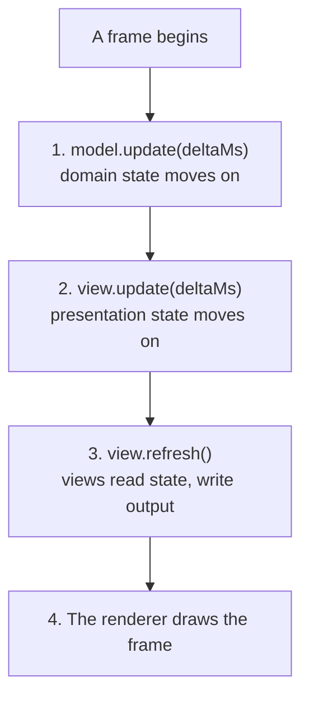

# Why MVT

> A game has three jobs: deciding what happens, showing it, and keeping
> time. When one function does all three, every change to one job affects
> the other two. MVT (Model-View-Ticker) assigns each job to one part: a
> model decides, a view shows, and a ticker keeps time and calls the other
> two in a fixed order every frame. You get games you can test without a
> screen, pause and replay, and draw any way you like, in exchange for a
> little more structure.

**Related:** [A First Game](03-a-first-game.md) ·
[The Eight Principles](25-the-eight-principles.md) ·
[MVT on One Page](../appendices/a-mvt-on-one-page.md) ·
[Glossary](../appendices/b-glossary.md)

Here is a ball that falls, bounces on the floor, and flashes white each
time it lands. It's written the way most first games are, in one function
that runs every frame. In it, `app` is a Pixi `Application` with a canvas
400 pixels wide and 300 high.

```ts
const ball = new Graphics().circle(0, 0, 15).fill(0xffffff);
ball.tint = 0x44aaff;
ball.position.set(200, 100);
app.stage.addChild(ball);

let vy = 0; // pixels per ms

app.ticker.add((ticker) => {
    vy += 0.0015 * ticker.deltaMS;
    ball.y += vy * ticker.deltaMS;
    if (ball.y > 285) {
        ball.y = 285;
        vy = -vy * 0.7;
        // Flash white for a moment on each bounce
        ball.tint = 0xffffff;
        setTimeout(() => { ball.tint = 0x44aaff; }, 100);
    }
});
```

It works, and it's short. Now try a few ordinary requests:

- **Test that the ball comes to rest.** The ball's height lives in a Pixi
  `Graphics`, so the test needs Pixi. Time comes from Pixi's ticker and
  from `setTimeout`, so the test has to wait in real time, or fake the
  clock.
- **Draw it twice as big.** The physics is in pixels. The floor is at 285
  because the canvas is 300 high and the ball's radius is 15. Change the
  screen, and you change where the ball bounces.
- **Add slow motion.** You can slow Pixi's ticker down, but the flash's
  `setTimeout` runs on the wall clock. The ball falls slowly and the flash
  ends at full speed. Pausing has the same problem.
- **Show the ball's height as a number, too.** The height is stored in the
  sprite, so the second display has to read one view to draw another.

Each request is about one thing, but each one runs into something else.
That's because the function does three jobs at once. It decides what
happens: gravity, the bounce, the loss of speed. It shows what happened:
the sprite's position and the flash. And it keeps time, with Pixi's ticker
for the fall and `setTimeout` for the flash. The jobs share variables, so
you can't change one of them on its own.

## Three Jobs, Three Owners

MVT assigns each of the three jobs to its own part.

- **The model** decides what happens. It holds the game's state, such as
  the ball's position and speed, and the rules that change it. It has no
  reference to the views that show it, and it moves forward in time only
  when its one method for that, `update(deltaMs)`, is called. `deltaMs` is
  the number of milliseconds since the last frame.
- **The view** shows what the model holds. Each frame, it reads the state
  and writes it to the screen, the speakers, or anything else that
  presents it. It decides how things look, never what happens. It reads
  the model through a small object called its bindings
  ([Chapter 8](08-bindings.md)), and reports the player's input the same
  way.
- **The ticker** keeps time. Each frame, it measures how long has passed,
  passes that time to the models, then the views, and then calls the
  renderer to draw. It doesn't hold any game rules, and it doesn't draw
  anything.

| Part | Its job | Its inputs | Never does |
| --- | --- | --- | --- |
| **Model** | Decides what happens, and owns the state that decides it | `deltaMs`, and the player's actions | References views, or reads the clock |
| **View** | Shows the state, and reports the player's input | The state, through its bindings | Keeps state that decides what happens, or keeps its own clock |
| **Ticker** | Keeps time, and calls the others in order | A callback from the browser each frame | Holds game rules, or draws anything |

Keeping different jobs apart, each with its own owner, is a design
principle called Separation of Concerns (SoC). It's the first of the eight
principles that [Chapter 25](25-the-eight-principles.md) introduces,
and the rest of MVT builds on it.

Look at the requests again with the jobs apart. The test creates a model,
calls `update` a few hundred times, and reads the height, with no screen.
The view draws the model's world at any size, and the model doesn't
change. Slow motion is the ticker passing a smaller `deltaMs`, and
the flash slows too, because it gets its time from the ticker like
everything else. A second display reads the same model as the first.
[Chapter 3](03-a-first-game.md) untangles this ball into those three parts.

In [§](#try-untangled-ball), the ball's jobs are split apart, flash and
all, and a second view shows its height. Press Step just before the ball
lands, which pauses it, then press Step again to move it on one tick at a
time. The flash lasts the same few ticks however slowly you step, because
the view times it with the ticker's time, just as the model moves with it.
Press Restart to drop the ball again.

<TryIt example="untangled-ball" file="views/ball-view.ts" />

## Two Kinds of State

The ball's height and the flash are both state, but they aren't the same
kind. One question tells them apart. If you took away every view, would
anything in the game happen differently?

- **Without the height and speed**, the ball wouldn't fall or bounce. They
  decide what happens. That makes them **domain state**: the state that
  decides the game's outcomes, such as a hit landing, a ball coming to
  rest, or a level ending. Models own it.
- **Without the flash**, the ball would bounce in exactly the same places
  at exactly the same times. The flash only changes how the bounce looks.
  That makes it **presentation state**: state that changes how things are
  shown, such as how far a fade has got, or a score counter rolling up to
  the new score. The view that shows it owns it.

| | Domain state | Presentation state |
| --- | --- | --- |
| Example | The ball's height and speed | How long the flash has left |
| Owned by | A model | The view that shows it |
| Moves forward in | The model's `update(deltaMs)` | The view's `update(deltaMs)` |
| Without it | The game plays differently | Only the presentation changes |

MVT handles both kinds the same way. Each has one owner, and each moves
forward with time that comes from the ticker. That's why a flash timed by
the view still slows down with the game: its owner gets its `deltaMs` from
the same ticker as the model. Most views don't have any presentation
state, and only read and show. A view that does have some gains an
`update(deltaMs)` step of its own.

The one difference is direction. Presentation state may follow domain
state. The flash starts when the ball bounces. But domain state never
depends on presentation state. If the game would play differently without
some piece of state, that state is domain state, and it belongs in a
model, however visual it seems. [Chapter 11](11-presentation-state.md)
shows how a view keeps presentation state, and how to decide the cases
that aren't obvious.

## The Tick in One Picture

Every frame, the ticker does the same four things, in the same order:



One turn of this loop is a **tick**. The ticker ticks the models, then the
views, then the renderer draws. Ticking a model means calling its
`update(deltaMs)`. Ticking a view means calling its `update(deltaMs)`, if
it has one, then its `refresh()`, the step that reads the state and writes
the view's output. Only views with presentation state have an `update`
step, so the second of the four is often empty.

The order is the point. Every model has finished moving before any view
reads it, so views never see a world that's half updated, and two views
that show the same thing always agree. [Chapter 5](05-the-tick.md) follows
a tick through in detail, and shows what the ticker can do by choosing
which `deltaMs` to pass.

## Trade-offs of MVT

- **Views read every value, every frame.** A view doesn't wait for an
  event to say that something changed. It reads what it shows on every
  frame, whether it changed or not. Each read is a quick function call,
  and at game scale, all of them together take a small part of a frame.
  Where a change sets off slow work, such as laying out text, the view
  does that work only when the value changes
  ([Chapter 9](09-noticing-changes.md)).
  [Chapter 10](10-why-views-poll.md) weighs this choice against events and
  signals, with measurements.
- **More parts.** The bouncing ball becomes a model, a view and a loop. In
  a game jam, the extra structure may not be worth it. It becomes worth it
  as soon as you want to test a rule, add a second view, or change one job
  without breaking another.
- **Moments need a trace.** A view can read only the state that the model
  holds when the view refreshes. A bounce that starts and ends inside one
  `update` doesn't leave anything to read, so the model keeps a value that
  a view can read, such as a count of bounces
  ([Chapter 4](04-models.md)). Thinking in states rather
  than events takes a little practice.
- **Tools that keep their own time need care.** Timers and animation
  libraries that run themselves can't move a model forward, because they
  don't use the ticker's time. You drive them from `update(deltaMs)`
  instead. [Appendix E](../appendices/e-timelines-with-gsap.md) shows how
  for GSAP, a popular animation library.

## Patterns You May Know

MVT puts together ideas that have been used for decades. If you know one
of them, this table shows where it fits, and where MVT differs.

| If you know | In MVT | How it differs |
| --- | --- | --- |
| The game loop of an engine such as Unity or Godot | The **ticker** | The same idea. MVT adds a fixed order: every model, then every view |
| The model in MVC | The **model** | The same idea: state and rules, which don't reference views |
| The controller in MVC | Split between the view and the ticker | The view reports input to the model through its bindings, and the ticker keeps time |
| Data binding in MVVM | **Bindings** | MVT's bindings are plain functions and values that the view reads every frame, not subscriptions that push changes |
| Passive View | The **view** | Like a passive view, it doesn't hold any state of its own that matters. Unlike one, it reads the state itself instead of having it pushed in |
| Immediate-mode drawing, such as Dear ImGui | How a view reads | Every frame, a view reads all the state it shows, as if drawing from scratch |
| A retained scene graph, such as Pixi's or the DOM | What a view writes | The view builds its display objects once, and changes their properties each frame |
| State in React or Redux | The **model** | One owner for each piece of state. MVT's models also own time |

The biggest difference from most UI architectures is that MVT is built
for things that move all the time. Views don't wait for an event to
redraw.
The ticker runs every frame, the models move forward, and the views catch
up.

## Summary

A game that decides, shows and keeps time in one place is hard to test,
hard to resize and hard to slow down, because each job shares its
variables with the others. MVT assigns the jobs to three parts. A model
decides what happens and owns the domain state, and moves only when
`update(deltaMs)` is called. A view shows the state and owns any
presentation state, which never feeds back into what happens. A ticker
keeps time, and every frame ticks the models, then the views, then lets
the renderer draw. In return for a little more structure, you get models
you can test without a screen, a renderer or any waiting. You get views
you can replace, add to or run without, because views never hold state
that decides what happens. Pause, slow motion and replays come from
the ticker choosing which `deltaMs` to pass. And every view shows the same
moment, because every model finishes updating before any view reads
it.

## Further Reading

- Robert Nystrom, *Game Programming Patterns* (2014). The "Game Loop" and
  "Update Method" chapters describe the two patterns at the heart of the
  ticker and the model.
- Edsger W. Dijkstra, "On the role of scientific thought" (1974). The
  essay that named the separation of concerns.
- Martin Fowler, ["Passive View"](https://martinfowler.com/eaaDev/PassiveScreen.html)
  (2006). A view without logic, tested apart from the rest of the program.
- John Gossman, "Introduction to Model/View/ViewModel pattern for building
  WPF apps" (2005). The ViewModel, and the data binding that bindings
  resemble.
- Evan Czaplicki, ["The Elm Architecture"](https://guide.elm-lang.org/architecture/),
  in the official Elm guide. A model, an update and a view, as a loop of
  plain functions.
