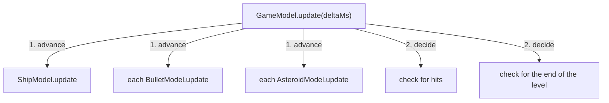

# Models

> A model is the part of your game that decides what happens. It owns the
> domain state, moves forward in time only when its `update(deltaMs)` is
> called, and has no reference to the views that show it. That makes it a
> simulation you can run anywhere: in the game, in a test, or without a
> screen, with the same result every time. Keep the clock, the screen and
> the controls out of it, and a model reads like the game's rules. A big
> game is a tree of small models, where each parent updates its children
> in the order that its rules require.

**Related:** [The Tick](05-the-tick.md) ·
[Time and Phases](06-time-and-phases.md) · [Views](07-views.md) ·
[Testing Models](15-testing-models.md) ·
[Single Source of Truth](27-single-source-of-truth.md) ·
[Dependency Inversion](29-dependency-inversion.md)

Here's a shield that protects the player for three seconds. It's written
the obvious way, with a timer:

```ts
function createShieldModel(): ShieldModel {
    let isRaised = false;

    return {
        get isRaised() { return isRaised; },
        raise() {
            isRaised = true;
            setTimeout(() => { isRaised = false; }, 3000); // the problem
        },
    };
}
```

It works until someone pauses the game. The game stops, but `setTimeout`
keeps counting on the wall clock, so the player comes back from the pause
menu with the shield gone. Slow motion has the same problem in reverse.
A test of the shield has to wait three real seconds, or replace the
browser's clock. And a bug report can't be replayed, because the shield
drops at a slightly different moment every run.

The fix is to pass the time to the shield, through a method of its own:

```ts
/** How long the shield stays up once it's raised, in ms. */
const SHIELD_MS = 3000;

function createShieldModel(): ShieldModel {
    let remainingMs = 0;

    return {
        get isRaised() { return remainingMs > 0; },
        raise() { remainingMs = SHIELD_MS; },
        update(deltaMs) {
            remainingMs = Math.max(0, remainingMs - deltaMs);
        },
    };
}
```

Now the shield moves forward only when `update(deltaMs)` is called. Pause
the game, and the ticker stops calling it, so the shield stays as it is.
A test calls `update` with three seconds' worth of frames, and checks
`isRaised` at once. Every run with the same calls ends the same way.

[§](#try-shield-on-the-clock) shows both shields side by side, the
`setTimeout` one on the left. Both shields go up as the example starts.
Press Step while they're up, which pauses the example, count to five, and
press Normal. The left shield dropped while the game was paused. The right
one stayed up, and still has the rest of its three seconds. Press
`raise()` to try again.

<TryIt example="shield-on-the-clock" file="models/shield-model.ts" />

## The `update(deltaMs)` Contract

Every model has an `update(deltaMs)` method. Each frame, the ticker calls
it with `deltaMs`, the number of milliseconds since the last frame. It is
the only way time gets into a model.

That one rule gives you three guarantees:

- **The model is deterministic.** The same series of `update` calls, with
  the same input between them, always leaves the model in the same state.
  A test can replay exact frames, and so can a replay system. It also
  makes lockstep networking possible: each player's machine runs the same
  game, and they share only their inputs.
- **The ticker controls time.** It can pause a game by not calling
  `update`, slow it down by passing smaller values, or step it one frame
  at a time. The model's code is the same either way.
  [Chapter 5](05-the-tick.md) shows how.
- **The model holds still while views read it.** Between a model's
  `update` and the views reading it, the model stays exactly as `update`
  left it. The model doesn't use timers, so a timer can't fire and change
  it halfway through a frame.

MVT has two requirements for a model. It moves forward in time only through
`update(deltaMs)`, and it never refers to a view or a renderer. Everything
else, such as whether you write it as a class or a function, and how you
name things, is your choice.

## Splitting Concerns Between Model and View

A model describes what is happening in the game's own terms. Views
describe how it looks. One test sorts most cases: if a value would change
when you swapped the renderer, it belongs in the view.

| Concern | In the model | In the view |
| --- | --- | --- |
| Position, speed and size | Units that mean something in the game ([below](#domain-coordinates)) | Pixels, screen offsets, sprite scale |
| How something looks | Named states, such as `'inflating'`, and a colour that's a rule of the game, such as a gem's `color: 'red'` | Colour values, textures, tints |
| Progress through a change | A phase and a progress, such as `phase: 'opening'` and `progress: 0.3` | Sprite frames, fades, particles |
| Layout | How many items, the grid's size | Spacing, margins, font sizes |
| Sound | What happened, as state that a view can notice, such as `phase: 'dying'` or `shotsFired` | Which sound plays, how loud, at what pitch |
| Timing | Timers advanced in `update(deltaMs)` | Timers for effects that don't change anything in the game |

## Things to Keep Out of a Model

A model never gets its time from outside `update`, and never depends on
anything to do with showing the game.

| Keep out | Why |
| --- | --- |
| `setTimeout`, `setInterval` | They fire on the wall clock, not the game's time |
| `requestAnimationFrame` | It runs on the browser's schedule, not the ticker's |
| `Date.now()`, `performance.now()` | Reading the clock makes every run different |
| Animations that play themselves | They advance on their own clock, as the shield's timer did |
| References to views | The model must work with any view, or without one |
| Pixel coordinates, colour values, texture names | They're decisions about how the game looks |

A colour can still be domain state. In a game where three red gems in a
row disappear, "red" is a rule, and the model holds it. Which shade of
red, and which texture draws it, stay in the view.

Animation libraries can still help a model, as long as the model drives
them from `update(deltaMs)`.
[Appendix E](../appendices/e-timelines-with-gsap.md) shows how with GSAP,
a popular animation library that several of the arcade's games use.

Randomness is a similar case. A model that calls `Math.random()` produces
a different result every run. A model that receives a function for random
numbers, as an option, can receive a predictable one in a test.
[Dependency Inversion](29-dependency-inversion.md) shows
the pattern.

### State at module level is shared

Keep a model's state inside the model. A variable declared at the top of
the model's file looks private, but it isn't private to one model. Every
model that the file creates shares it:

```ts
let nextId = 1; // the problem: shared by every model this file creates

export function createEnemyModel(options: EnemyModelOptions): EnemyModel {
    const id = nextId++;
    // ...
}
```

The first game's enemies are numbered from 1. The second game's carry on
from wherever the first left off, and so does every test after the first.
The same calls no longer produce the same state, because the result depends
on what ran before. Move the variable into the factory that owns it, such
as the game model that creates the enemies, and pass it down as an
option if a child needs it.

## Domain Coordinates

A model exposes positions, distances and speeds in units that mean
something in the game, never in pixels.

| Kind of game | Natural unit | Examples |
| --- | --- | --- |
| Tiles or a grid | Tiles, with fractions while moving | Maze games, falling-block puzzles |
| An open world | Metres, or world units | Platformers, racing games |
| A fixed arena | World units | Space shooters |
| A board or a table | Squares, slots, indexes | Chess, card games |

For something that moves on a grid, such as a cat in a maze, the model
can expose a fractional `row` and `col`. A whole number means the cat is in
the middle of a tile, and a fraction means it's between two:

```ts
export interface CatModel {
    /** The row, with a fraction while moving between tiles. */
    readonly row: number;
    /** The column, with a fraction while moving between tiles. */
    readonly col: number;
    readonly direction: Direction;
    readonly update: (deltaMs: number) => void;
}
```

The view turns tiles into pixels in its refresh step:

```ts
sprite.position.set(
    (bindings.col() + 0.5) * TILE_SIZE,
    (bindings.row() + 0.5) * TILE_SIZE,
);
```

In [§](#try-cat-in-tiles), that cat explores a small maze. Watch the
numbers below the maze: the row or the column is a whole number in the
middle of a tile, and has a fraction between two. Press View code, open
`views/tile-size.ts`, and change `TILE_SIZE`. The maze is drawn bigger or
smaller, and the cat walks it just the same, because its model counts in
tiles.

<TryIt example="cat-in-tiles" file="views/tile-size.ts" />

For an open arena, the model uses units of its own, and the view scales
them:

```ts
// In the model, in world units
const ARENA_WIDTH = 400;
const SHIP_RADIUS = 10;
const THRUST = 0.002; // world units per ms, per ms

// In the view, worked out once
const scale = screenWidth / ARENA_WIDTH;
```

Even if the view happens to draw one world unit as one pixel, the view
decides that, not the model. The model defines the world, and the view
decides how to draw it. When the screen changes size, only the view
changes.

## Writing a Model as a Factory

This book writes each model as a factory function: a function named
`createXxxModel` that takes one options object and returns a plain object
that matches an interface. This is a style, not something MVT requires.

```ts
export interface ShipModel {
    /** The ship's position, in world units. */
    readonly x: number;
    readonly y: number;
    /** Whether the player is holding the thrust on. */
    isThrusting: boolean;
    readonly update: (deltaMs: number) => void;
}

export interface ShipModelOptions {
    readonly startX: number;
    readonly startY: number;
}

export function createShipModel(options: ShipModelOptions): ShipModel {
    // Private state, inside the function
    const x = options.startX;
    let y = options.startY;
    let vy = 0;

    const model: ShipModel = {
        get x() { return x; },
        get y() { return y; },
        isThrusting: false,

        update(deltaMs) {
            const thrust = model.isThrusting ? THRUST : 0;
            vy += (GRAVITY - thrust) * deltaMs;
            y += vy * deltaMs;
            // ...then the ground and the sky stop the ship
        },
    };
    return model;
}
```

The ship's `x`, `y` and `vy` live inside the function, where code outside
the function can't reach them, and code that uses a ship depends only on
the `ShipModel` interface. A class would meet MVT's requirements just as
well, and
[Code Style](../working-in-this-repo/code-style.md#why-factory-functions-not-classes)
explains why this repo chooses factories.

## Actions Say What the Player Means

The player's input reaches a model as a change of state or a call to an
action. Name both for what the player means, never for the control they
used:

| Kind of input | Name it like this | Not like this |
| --- | --- | --- |
| A control held down | State, such as `isThrusting` | `thrustPressed`, `upKeyDown` |
| A one-off command | An action, such as `startNewRun()` | `restartPressed()`, `onEnterKey()` |

The model doesn't depend on whether the player used a key, a touch or a
game pad, and it shouldn't. The code that connects the controls to the model
says what each control means: the up arrow and a thumb on the screen can
both set `isThrusting`. A test reads like the game's rules, too:
`ship.isThrusting = true` says what's happening, where
`ship.thrustPressed = true` says only which key was down.
[Chapter 8](08-bindings.md) shows how a view reports input.

[§](#try-thrusting-ship) runs the ship from the last section. Hold the up
arrow or the space bar, or press and hold on the game, and the ship
climbs. All three controls set the same `isThrusting`. Press View code to
see where: `views/ship-view.ts` says what each control means, and the
model in `models/ship-model.ts` never references keys or touches.

<TryIt example="thrusting-ship" file="views/ship-view.ts" />

An action also enforces the model's rules. A chest's `open()` opens the
chest only if it's closed, so a caller can't open it twice. The view
decides what a button does, and the model decides whether it's allowed.

## State That Views Can Notice

A view reads the model every frame, and can read only the state that the
model holds at that moment. That shapes what a model exposes.

- **A phase for each stage of something.** A game that is `'playing'`,
  then `'dying'`, then `'game-over'` lets every view read which stage the
  game is in, and notice when a stage begins.
  [Chapter 6](06-time-and-phases.md) shows how to model phases.
- **A count for a moment that repeats.** A shot is over within one
  `update`, and two shots in a row look the same as one if all you can
  see is "a shot is happening". So the model counts them: `shotsFired`
  rises by one for each shot. A view plays a sound each time the count
  rises. [Chapter 9](09-noticing-changes.md) shows how a view notices.

The model keeps these for itself as much as for its views. A count of
shots is a fact about the game, which a test can check as easily as a
view can show it.

## Trees of Models

A real game is too big for one model. You split it into a tree: a game
model that owns a ship, a list of asteroids and a list of bullets, and
perhaps a level model above them all. The ticker calls `update` on the
model at the root of the tree, and each model calls `update` on its own
children.



The parent advances its children first, then decides what they did to
each other:

```ts
export function createGameModel(options: GameModelOptions): GameModel {
    const ship = createShipModel(options.ship);
    const asteroids = createAsteroids(options.level);
    let score = 0;

    return {
        get ship() { return ship; },
        get asteroids() { return asteroids; },
        get score() { return score; },

        update(deltaMs) {
            // 1. Advance every child
            ship.update(deltaMs);
            for (let i = 0; i < asteroids.length; i++) {
                asteroids[i].update(deltaMs);
            }

            // 2. Then decide what the children did to each other
            checkShipAgainstAsteroids();
        },
    };

    function checkShipAgainstAsteroids(): void {
        // ...
    }
}
```

A parent calls each child's `update` itself, because the order is part of
the game's rules. Views are reached differently, and
[Chapter 5](05-the-tick.md#trees-the-ticker-calls-only-the-roots)
explains why.

[Burrow Bust](https://github.com/yortus/mvt-games/blob/main/packages/sites/arcade/src/entries/burrow-bust/models/game-model.ts),
one of the arcade's games, shows what a parent's `update` decides. Its
game model moves the digger before the enemies, so each enemy chases the
digger from where it is now, not where it was a frame ago. It checks for
digging, hits and crushing rocks only after everything has moved. And
while the digger is dying, it doesn't update the field, the digger, the
enemies or the rocks at all, so the whole level holds still. Each of
those is a rule, and the parent's `update` is where you can read it.

Each child can still be tested alone. A test creates a ship and calls its
`update`, with no game around it. The parent's tests check the rules that
only the parent applies, such as whether a hit scores.
[Chapter 15](15-testing-models.md) covers both.

### Siblings interact through their parent

A child never holds a reference to its parent or its siblings. When two
children need to interact, the parent handles the interaction:

- **Collisions.** The parent reads both children's positions, and calls
  an action on each, such as `asteroid.split()` or `ship.destroy()`.
- **Scoring.** The parent adds to the score when it detects a hit, rather
  than passing the score model to each bullet.
- **Spawning.** The parent creates new children, such as the two small
  asteroids that a big one splits into.

Sometimes a child does need to read state that it doesn't own. Then the
parent passes it a narrow interface to exactly that state, as one of its
options. Burrow Bust's enemies need to read which tiles they can walk on,
and where the digger is:

```ts
export interface EnemyModelOptions {
    // ...
    /** Whether the tile can be walked on. */
    readonly isWalkable: (row: number, col: number) => boolean;
    /** What the enemy chases, such as the digger. */
    readonly chaseTarget: { readonly row: number; readonly col: number };
}
```

The game model passes a function that queries the field model, and
passes the digger model itself as `chaseTarget`. The enemy can read only
a `row` and a `col`. Its code doesn't reference the digger at all, and a
test can pass it a plain `{ row: 3, col: 4 }`.

Two principles meet here. The enemy declares what it needs, and its
parent supplies it. That's the
[Dependency Inversion Principle](29-dependency-inversion.md).
And it reads the field and the digger rather than keeping copies of them,
so there's one answer to "where is the digger?". That's
[Single Source of Truth](27-single-source-of-truth.md).

## Collections of Models

Many games have collections whose items come and go: bullets, enemies,
explosions. A plain array works, but it has two snags as items leave.
Removing an item shifts every later item to a new index, so anything that
followed "item 3" now follows a different item. And a removed item is
gone at once, so an explosion doesn't get time to fade.

A slot list avoids both. Each item gets a slot, a numbered place it keeps
for its whole life. When an item is removed, its slot can stay readable
for a short delay, so a view can show it leaving, and then the slot is
freed for a new item.

::: info In this book
`createSlotList`, from `@mvtjs/utils`, makes a slot list. Here is a
model's list of bullets, with a limit of three on screen at once:

```ts
const bullets = createSlotList<BulletModel>({ maxSlots: MAX_BULLETS });

function fire(): void {
    if (bullets.isFull) return;
    bullets.insert(createBulletModel({ x: ship.x, y: ship.y }));
    shotsFired++;
}

function updateBullets(deltaMs: number): void {
    for (let i = 0; i < bullets.slots.length; i++) {
        const slot = bullets.slots.at(i);
        if (slot === undefined) continue;
        slot.value.update(deltaMs);
        if (slot.value.y < 0) bullets.remove(slot);
    }
    bullets.update(deltaMs);
}
```

`slots.at(i)` returns the slot at `i`, or `undefined` if it's free.
`remove` takes an item out of play. With a `releaseDelayMs` option, its
slot stays readable for that long before it's freed, which is how an
explosion gets time to fade. The list's own `update(deltaMs)` moves that
delay on, so the model calls it every tick. `maxSlots` is a rule of the
game, such as three bullets at once, not a setting for speed. Leave it
out if the game doesn't limit the number of items.
:::

[Chapter 14](14-lists-and-switches.md) shows the view side: a view for
each slot, built once and reused.

## Common Mistakes

### Pixels in a model

Resizing the screen, or drawing the game at a different scale, changes how
the game plays. That happens when the model stores positions or speeds in
pixels, so the screen's size has leaked into the rules. Give the model its
own units, such as tiles or world units, and let the view convert them.

### A timer on the wall clock

Pausing the game doesn't pause something, tests fail now and then, or a
bug won't happen the same way twice. The model is using `setTimeout`,
reading `Date.now()`, or starting an animation that plays itself. Keep a
number of milliseconds instead, and move it on in `update(deltaMs)`, as
the shield does.

### Models that share state through the module

The first game works, but the second starts with odd numbers or a
different pattern, and a test passes alone but fails after another. A
variable at the top of the model's file is shared by every model that
the file creates, so each one starts where the last left off. Move the
variable into the factory that owns it, as
[§](#state-at-module-level-is-shared) shows.

### A child that references its sibling

You can't test a child model without building the whole game around it.
The child imports another model, or holds a reference to one, to read its
state. Let the parent mediate instead, or pass the child a narrow function
or object as an option, as Burrow Bust does with `isWalkable` and `chaseTarget`.

### A model named after its controls

Adding touch controls, or a second key for the same thing, means changing
the model. Its interface has `thrustPressed` or `restartPressed`, so it
depends on the controls. Expose state for what the player is doing
(`isThrusting`), and an action for what they asked for (`startNewRun()`).

### A child that's never updated

A child model sits still, or a slot list's removed items never leave. The
parent's `update` doesn't call the child's, or the slot list's. Call every
child's `update(deltaMs)` from the parent's `update`. The `@mvtjs` slot
list helps: in a development build, it throws if many items
wait to be freed and its `update` has never been called.

## Summary

A model owns the domain state and the rules that change it, and moves
forward only when `update(deltaMs)` is called. It never reads the clock,
never refers to a view, doesn't keep any state at the top of its file,
and measures the world in its own units. In this book a model is a
factory function that returns an object matching an
interface, though a class would do as well. Input arrives as state or
actions named for what the player means. A model exposes what happened
as state that a view can read, such as a phase or a count. Models combine
into a tree, and each parent updates its children itself, in the order
that its rules require, then decides what they did to each other.
Children never reference each other: the parent mediates, or passes a
child a narrow interface to the state it reads. Collections whose items
come and go fit a slot list, where each item keeps its place for its life.
