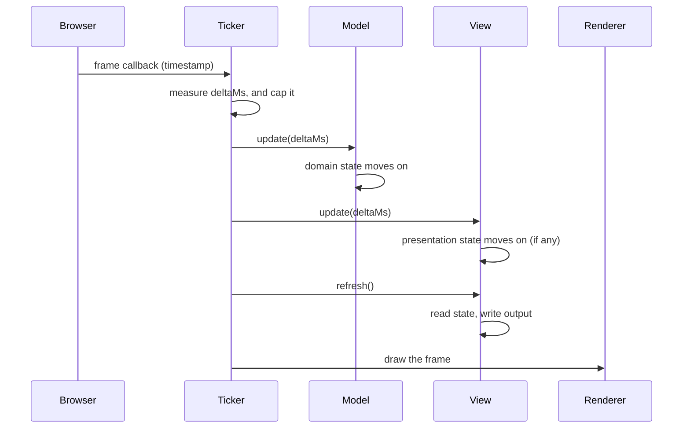

# The Tick

> Every frame, the ticker measures how much time has passed, ticks the
> models, then the views, and then calls the renderer to draw. Because of
> that fixed order, a view can rely on the state it reads: every model
> has finished updating, every view reads the same moment, and a view
> can't change the state of the frame it's drawing. The ticker also owns
> time. By choosing which `deltaMs` to pass, it can pause a game, slow it
> down, speed it up, step it and replay it, without any change to the
> game's code.

**Related:** [Why MVT](02-why-mvt.md) · [Models](04-models.md) ·
[Time and Phases](06-time-and-phases.md) ·
[Presentation State](11-presentation-state.md) ·
[Hot Paths](24-hot-paths.md)

Here's a game loop that updates each part of the game and draws it in
turn:

```ts
function frame(deltaMs: number): void {
    ship.update(deltaMs);
    shipView.refresh();      // draws the ship, alive
    asteroids.update(deltaMs);  // ...and an asteroid hits it here
    asteroidsView.refresh();
    livesView.refresh();     // shows one life fewer
}
```

It looks tidy, and most frames it's fine. But on the frame an asteroid
hits the ship, the ship view has already drawn the ship alive, and the
lives view, which refreshes after the hit, shows a life lost. For one
frame the screen disagrees with itself. Worse, whether a view shows the
hit depends on its place in the list. Move `livesView.refresh()` up one
line, and the bug moves with it.

The fix is an order that doesn't depend on where each call sits in the
list: every model first, then every view.

## Ticks

One turn of the ticker's loop is a **tick**. The word also covers each
part of the turn. To tick something is to run its part of the turn:

| Part | Ticking it |
| --- | --- |
| A model | Calls its `update(deltaMs)` |
| A view | Calls its `update(deltaMs)`, if it has one, then its `refresh()` |
| A view with child views | Every update step in it, then every refresh step, parents before children |
| The whole game | Ticks the models, then the views, then the renderer draws |

A view's tick never runs before the models' ticks in the same frame. In
the loop above, each part was ticked whole, one after another. A tick
splits the work by kind instead: every model, then every view.

A tick isn't quite the same as a frame. A **frame** belongs to the
browser: the browser calls the ticker once each time it's about to draw a
new picture. A tick is the ticker's own turn. In a running game there's
one tick per frame, which is why this book often says "every frame" for
"every tick". But the two differ in a few cases. A test ticks a model
without any frames
([Chapter 15](15-testing-models.md)). A paused game still has frames, but
its models aren't ticked. And to fast-forward, the ticker can tick the
models many times in one frame, as [Time Control](#time-control) shows.
Where the difference matters, the book says "tick".

## The Frame Sequence in Detail

[Chapter 2](02-why-mvt.md) drew a tick in one picture. Here is the full
sequence, including where the time comes from:



The browser calls the ticker once a frame, through
`requestAnimationFrame`, with a timestamp. The ticker computes `deltaMs`
as the time since the last timestamp, and caps it, as
[a later section](#the-delta-cap) explains. Here's the whole loop,
written by hand:

```ts
const MAX_DELTA_MS = 100;
let lastTime: number | undefined;

function frame(now: number): void {
    const elapsedMs = lastTime === undefined ? 0 : now - lastTime;
    lastTime = now;
    const deltaMs = Math.min(elapsedMs, MAX_DELTA_MS);

    game.update(deltaMs);            // 1. the models move on
    updateView(app.stage, deltaMs);  // 2. presentation state moves on
    refreshView(app.stage);          // 3. every view reads and writes
    app.render();                    // 4. the renderer draws

    requestAnimationFrame(frame);
}

requestAnimationFrame(frame);
```

The ticker calls only the model at the root of the model tree, and the
views at the root of the view tree. Everything below them is reached
from there, as [the last section](#trees-the-ticker-calls-only-the-roots)
explains.

In [Chapter 3](03-a-first-game.md), Pixi's ticker ran this loop, and
Pixi drew the frame after the callback returned. Any loop that keeps the
order works.

## Why the Tick's Order Matters

The order guarantees three things for every view.

- **Models settle first.** When a view reads the state, every model has
  finished moving for this frame. Views never see a world where the ship
  has moved and the asteroids haven't.
- **Views agree.** Two views that read the same value always get the same
  answer, because the state doesn't change between them. The ship view
  and the lives view from the opening example now both show the hit, on
  the same frame, wherever they are in the list.
- **Data flows one way.** A view never changes a model while it
  updates or refreshes. It only reads. So the state that one view reads
  can't be changed by another view earlier in the same frame. The models
  produce state, and the views show it.

The order doesn't depend on how the views are arranged, or on which one
happens to refresh first. This is why adding a view can never break
another.

All three guarantees rest on one rule: **models never change while views
update or refresh.** Every step in a tick is synchronous, so each step
finishes before the next begins. The guarantees come from the split between
the models and the views. The split between a view's two steps does a
different job, which [Appendix I](../appendices/i-why-update-and-refresh.md)
describes.

## Input Between Ticks

The player's input doesn't arrive during a tick. Key presses and pointer
events come from the browser between frames. A view's binding passes
each one on, as soon as it arrives, by changing the model's state or
calling one of its actions ([Chapter 8](08-bindings.md) shows how). The
model acts on it in its next `update`, and the views show the result at
the next refresh.

Some models go one step further. They store what the player asked for,
and act on it inside `update`, so every change to the game happens in
`update`'s order. Burrow Bust's game model does this. Its `pump()` and
`startNewRun()` actions only set a flag, and its `update` reads each flag
at a fixed point and clears it. A pump asked for between frames takes
effect at the same point in the update as one asked for at any other
time.

Either way, input never reaches a model while views update or refresh, so
the three guarantees hold. A view sometimes notices input during a tick,
such as a long press that ends when enough game time has passed. It reports
that input after the tick, so it reaches the model between ticks too
([Chapter 8](08-bindings.md#relay-bindings-and-input-handling) shows how).

## The Delta Cap

`deltaMs` isn't the same every frame. It's however long the last frame
took: about 7 ms on a 144 Hz screen, 16 ms at 60 Hz, 33 ms on a phone
that draws 30 frames a second, and more after a slow frame. And when a
browser tab goes into the background, the browser stops calling
`requestAnimationFrame`. Come back a minute later, and the next frame's
timestamp is a minute after the last. Passed on as it is, that becomes a
single `update(60000)`.

Most models would handle that badly. A ball moving at speed jumps straight
through a wall instead of hitting it. Even with a model that keeps exact
time, the player misses a whole minute of play, which happens in one
frame. A countdown hits zero before the player has seen it move.

So the ticker caps `deltaMs`, typically at 100 ms. While the tab is
hidden, the game stays where it was, and it carries on when the player
comes back. A slow frame on a busy device plays a little slow,
rather than jumping.

The cap is also a guarantee for every model. Steps are never bigger than
the cap, so a model must produce the same results at any step size up to
the cap, and never has to handle a bigger step. The next chapter, in
[§](06-time-and-phases.md#steps-of-different-sizes), shows what that
requires of a model. Choose the cap for the most sensitive model in the
game, such as the fastest object and the thinnest wall it mustn't pass
through.

The smallest step is 0, because a ticker usually passes 0 on its first
tick. [§](04-models.md#the-update-deltams-contract) says what an `update`
does at 0.

In [§](#try-delta-cap), two balls roll between thin walls. The button,
"Take one 3-second step", passes each ball's model one big step between
the usual frames. It's the step that a ticker without a cap would pass on
the first frame after the tab was hidden for three seconds. The top ball
gets the whole 3000 ms, and the bottom ball gets a step capped at 100 ms.
Press the button, and the top ball jumps straight past its wall. Press
Restart to bring it back.

<TryIt example="delta-cap" file="main.ts" />

You may have heard of the "spiral of death". It belongs to a different
kind of loop, one that runs the models in fixed steps, several per frame
if it has fallen behind. If each step takes longer than the time it
covers, the loop falls further behind every frame. A ticker that calls
each model's `update` once per frame, as this book's does, never has to
catch up. Its cap protects against one huge step, not a spiral.

::: info In this book
Pixi's own ticker caps `deltaMS` at 100 ms by default, so a loop driven
by Pixi's ticker, as in [Chapter 3](03-a-first-game.md), has a cap
already.
:::

## Time Control

The ticker is the only source of `deltaMs`, so it decides how fast the
game's time runs. Each of these is a change to the ticker alone, and the
game doesn't need any code for them:

- **Pause.** Stop updating the models, but keep refreshing the views, so
  the frozen game still shows behind a pause menu.
- **Slow motion and fast forward.** Multiply `deltaMs` by 0.5, or by 2,
  before passing it on. Fast forward makes each step bigger, and a model
  handles steps only up to the cap. So cap the result as well, or run two
  updates of the usual size in each frame.
- **Stepping.** While paused, run one tick with a fixed `deltaMs`, such
  as 16, each time a debug key is pressed.
- **Replay.** Record each tick's `deltaMs` and the input that arrived
  before it. Play them back in order, and the models reach the same state
  every time. (If the game uses random numbers, record the seed too.)

Views with presentation state follow the same time. Pass them the same
scaled `deltaMs`, or don't update them while paused, and a fade slows down
or freezes with the game. Here is a loop with a pause and a speed control,
where the game and its menu sit in two separate containers on the stage:

```ts
function tick(deltaMs: number): void {
    if (!isPaused) {
        const gameMs = deltaMs * speed; // 0.5 for slow motion, 2 for fast
        game.update(gameMs);
        updateView(gameLayer, gameMs);
    }
    updateView(menuLayer, deltaMs);     // the menu runs in real time
    refreshView(app.stage);             // every view, paused or not
}
```

While the game is paused, `updateView` skips its container, but the
container is still refreshed, so it shows the game as it stood. The
game's models and views don't have any code for pausing.

[§](#try-pause-and-slow-motion) runs that loop, in its `main.ts`. It
starts in slow motion: watch the game's clock run at half the speed of the
real one, and the ball's flash slow down with it. Then press the game's
own Pause button, at the bottom left. The game stands still, but the
PAUSED sign keeps pulsing, because the menu runs in real time.

<TryIt example="pause-and-slow-motion" file="main.ts" />

Notice that the models and the views are ticked separately. So a test can
tick the models many times, and refresh the views once at the end, to look
at a game a minute into its play.

## Trees: The Ticker Calls Only the Roots

Models form a tree, and so do views. The ticker calls `update` on the
root model only, and ticks the root view only. Below the roots, models
and views differ:

- **Models delegate by hand.** Each parent calls its children's `update`
  itself, as [Chapter 4](04-models.md#trees-of-models) showed, because the
  order of their updates is part of the game logic. A parent decides
  which child moves first, whether a child moves at all, and when to
  check for collisions. A function that walked the model tree would make
  those decisions for the parent, in an order that the game logic
  didn't choose.
- **Views don't need to.** By the time any view runs, every model has
  finished updating, and views only read. The order of views never changes
  what they read from the models. Only one order can matter: a parent
  before its children, when the parent shares some of its own state with
  them, as [Chapter 18](18-growing-a-complex-view.md) shows. A walk
  guarantees that order for every view. A parent view could forward the
  tick to its children, but forwarding it doesn't gain anything. A function
  can walk the view tree instead, and call every view's steps, parents
  before children.

In this book, `updateView` and `refreshView`, which you met in
[Chapter 3](03-a-first-game.md#the-loop), are that walk.
[Chapter 7](07-views.md#updating-and-refreshing-views-with-the-mvtjs-libraries)
covers them in full, with views.

`update` and `refresh` run every frame, for every view and model, so the
code inside them is on the game's hot path. [Chapter 24](24-hot-paths.md)
shows what to avoid there.

## Common Mistakes

### A view that changes a model during a tick

Two views disagree for a frame, or a view's output depends on which views
ran before it. An update or refresh step is calling a model action, or
setting model state, directly or through a relay binding. So the views
after it read a different world from the views before it. Both steps should
only read the models. Pass input on from event handlers, which run between
ticks, and let the model act on it in its next `update`. If a view notices
input during a tick, it reports it after the tick, as
[Chapter 8](08-bindings.md#relay-bindings-and-input-handling) shows.

### An uncapped `deltaMs`

After you switch back to the game's tab, objects have passed through
walls, or a whole phase has been skipped. The ticker is passing the full
time since the last frame, which can be minutes. Cap `deltaMs`, typically
at 100 ms.

### A paused game that keeps moving

While the game is paused, a fade finishes, or a light keeps blinking. The
view's presentation state is still being updated, or the view keeps time
some other way, such as with `setTimeout`. Leave the paused game's views
out of the update step, as well as its models, and keep every timer in an
update step, so it gets its time from the ticker.

## Summary

A tick is one turn of the ticker's loop. Each frame, the ticker measures
`deltaMs` and caps it, ticks the root model, then ticks the views, update
steps before refresh steps, and then the renderer draws. Because every
model finishes updating before any view reads, views never see a
half-updated world, always agree with each other, and can't change the
state of the frame they're drawing. Input arrives between ticks, and
takes effect in the next `update`. The cap on `deltaMs` keeps a hidden
tab from turning into one huge step, and it's the biggest step that a
model has to handle. Because the ticker is the only source of time, it
can pause, slow down, speed up, step and replay a game, without any
change to the game's code. The ticker calls only the roots of the two
trees: models pass the tick on in their own order, and views can be
reached by walking the tree, as the `@mvtjs` libraries' `updateView` and
`refreshView` do.

## Further Reading

- Glenn Fiedler, ["Fix Your Timestep!"](https://gafferongames.com/post/fix_your_timestep/)
  (2004). Variable and fixed time steps, and how a loop can fall behind.
- Robert Nystrom, *Game Programming Patterns* (2014), the "Game Loop"
  chapter. The loop, its order, and how it keeps time.
