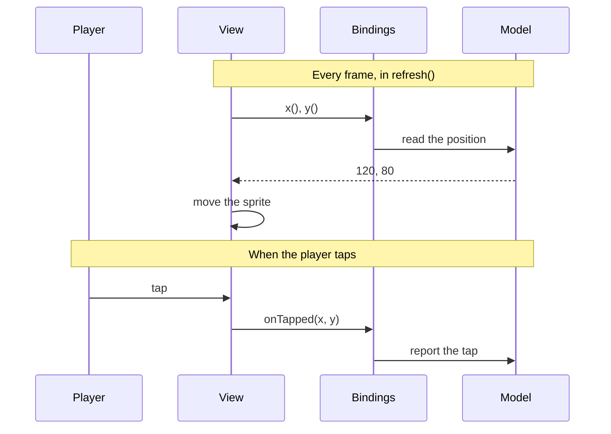

# Bindings

> A view's bindings are everything it needs from the rest of the program,
> in one plain object. Query bindings return the state that the view
> shows, and relay bindings report what the player did. Because the view
> reads only its bindings, its code is the same whether a model, another
> model, or a test supplies them. That makes it easy to reuse, easy to
> test, and honest about what it depends on.

**Related:** [Views](07-views.md) ·
[Noticing Changes](09-noticing-changes.md) ·
[Composing Views](13-composing-views.md) ·
[Lists and Switches](14-lists-and-switches.md) ·
[Dependency Inversion (DIP)](29-dependency-inversion.md) ·
[MVT on One Page](../appendices/a-mvt-on-one-page.md#binding-rules)

Here is a view that shows the player's lives as a row of icons. It
receives the whole game model, and reads the values it uses:

```ts
function LivesView(model: GameModel): Container {
    const view = new Container();
    const icons = createLifeIcons(view, MAX_LIVES);

    function refresh(): void {
        const lives = model.ship.lives;
        for (let i = 0; i < icons.length; i++) icons[i].visible = i < lives;
    }

    setRefresh(view, refresh);
    return view;
}
```

It works, and it's short. Now try a few ordinary requests:

- **Add a second player.** Their lives are in `model.player2.lives`, but
  the view can only read `model.ship.lives`. You need a second view, or a
  flag that picks which ship to read.
- **Test the view.** To see it with two lives, you have to build a whole
  game model and play it until the ship has lost one.
- **Rename `ship.lives` to `ship.livesLeft`.** The view breaks, though
  the way lives look hasn't changed.
- **Use the view in another game.** That game has a different model, so it
  can't.

Each of these comes from one thing: the view depends on the shape of the
model. Here is the same view, receiving only the value it shows:

```ts
interface LivesViewBindings {
    lives: () => number;
}

function LivesView(bindings: LivesViewBindings): Container {
    // ...as before, but reading bindings.lives()
}

LivesView({ lives: () => model.ship.lives });    // player one
LivesView({ lives: () => model.player2.lives }); // player two
LivesView({ lives: () => 2 });                   // a test
```

The view reads one value, the number of lives, and the code that creates
the view supplies it. Every request above becomes a change to the line
that creates the view, not to the view.

[§](#try-lives-view-bindings) puts those three lines to work, in a game
whose two ships lose their lives on their own. Press View code, open
`views/game-view.ts`, and give the third view's `lives` binding another
getter, such as one that returns the fewer of the two players' lives: `()
=> Math.min(model.ship.lives, model.player2.lives)`. You won't need to
touch `LivesView`.

<TryIt example="lives-view-bindings" file="views/game-view.ts" />

## The Bindings Object

A **bindings** object is a plain object that a view receives when it's
made. Its members are of two kinds:

| Kind | Purpose | Direction | Example |
| --- | --- | --- | --- |
| **Query binding** | Reading state that the view presents | Model to view | `x: () => number` |
| **Relay binding** | Reporting the player's input | View to model | `onTapped: (x: number, y: number) => void` |

The view calls its query bindings every frame, in `refresh()`, and calls
its relay bindings when the player does something:



The bindings type is a complete list of everything the view needs. The
view doesn't import a model, and doesn't depend on globals that must be
set up first. That's the same idea as
[Dependency Inversion](29-dependency-inversion.md): a
component declares what it depends on, and the code that creates it
supplies it.

## Query Bindings

A query binding returns part of the state that the view presents, such
as where the bullet is, whether it's visible, or the score. It returns a
value, and never changes any state. This is why `refresh()` can read
every query binding any number of times. (This is
[Command-Query Separation](28-command-query-separation.md)
at work.)

A caller supplies a query binding in one of two ways:

- **As a fixed value,** such as `size: 20`. The view reads it once, when
  it's made, and doesn't follow any later change.
- **As a function.** The view calls it whenever it reads the value, which
  in practice means every `refresh()`. This is how a view follows state
  that changes, such as a position.

A function that takes no arguments and returns a current value, such as
`score: () => number`, is called a
[getter](../appendices/b-glossary.md). Most query bindings are getters. A
function that takes arguments, such as `tileKindAt(row, col)`, returns the
value that its arguments select.

**Name a query binding for what it returns:** `x`, `score`, `isVisible`,
`tileKindAt(row, col)`. A `get` prefix, as in `getScore`, is common in
other codebases, and works just as well. Pick one style and keep to it.

::: info In this book
Query bindings never start with `get`. A boolean starts with `is`, `has`
or `can` (`isAlive`, `canFlip`). A query binding that takes a position or
an index ends in `At` (`tileKindAt(row, col)`), and one that takes a key
ends in `For` (`colorFor(kind)`). A bindings type is named for its view,
such as `HudViewBindings`, and the parameter is always `bindings`, never
`props`, even in JSX.
:::

## Relay Bindings and Input Handling

A relay binding is always a function, but not a getter. The view calls it
when the player does something, with the details of what happened, such
as where a tap landed:

```ts
interface ButtonViewBindings {
    label: () => string;
    isEnabled: () => boolean;
    onClicked?: () => void;
}
```

The view only reports the input. The code that wired the relay binding
decides what the input means. So **name a relay binding for what the
player did, not for what it should cause.** `onFirePressed` reports an
input. `onShoot` says that the input means shooting, and the view
shouldn't make that decision. The same fire button might shoot in one game,
jump in another, and close a menu in a third.

In [§](#try-stopwatch-buttons), a stopwatch has two buttons, both made by
this `ButtonView`. Click them, and watch Reset become enabled only while
the stopwatch is stopped. Then press View code, open
`views/stopwatch-view.ts`, and change Reset's `isEnabled` to `() => true`.
Now you can click it while the stopwatch runs, but the click doesn't do
anything, because the model decides that a running stopwatch can't be
reset. The button only reports the click.

<TryIt example="stopwatch-buttons" file="views/stopwatch-view.ts" />

The wiring decides what the input means, and passes the model that
meaning, never the control, as
[Chapter 4](04-models.md#actions-say-what-the-player-means) explains. The
view calls a relay binding as the input arrives, never from `refresh()`,
which only reads, and the model chooses whether to act on it at once or
at its next update ([Chapter 5](05-the-tick.md#input-between-ticks)).

## Fixed Values and Getters

For a query binding without arguments, the bindings type says which form
the view accepts, and so whether the view supports the value changing.
There are three choices:

| Declared as | Callers pass | Meaning for the view |
| --- | --- | --- |
| `() => T` | A getter. A fixed value has to be wrapped: `() => 42` | It follows the value as it changes. Following a change to something structural, such as a grid's size, can mean rebuilding |
| `T` | A fixed value | It reads the value once, and doesn't follow a change. This is the simplest to write, but every caller has to accept the limitation |
| `ValueOrGetter<T>`, which is `T \| (() => T)` | Whichever suits them | It follows a change, and handles both forms. The wiring shows which values are fixed and which change |

### Getters are read every frame

Most query bindings are getters. That's the flexible choice, and the
right one for anything that comes from model state. Supporting change
has one requirement. The view must read the getter again in `refresh()`,
every frame, and never read it once and keep the result:

```ts
// Wrong: read once, when the view is made
function BadView(bindings: GridViewBindings): Container {
    const rows = bindings.rows(); // never read again
    // ...
}

// Right: read every frame
function GoodView(bindings: GridViewBindings): Container {
    const view = new Container();

    function refresh(): void {
        const rows = bindings.rows(); // always current
        // ...
    }

    setRefresh(view, refresh);
    return view;
}
```

`BadView` works until the model's `rows` changes, for example on a restart
or a new level. Then it carries on showing the old grid. `GoodView` reads
the current value on the next frame. Where a change sets off slow work,
such as rebuilding the grid, [change detection](09-noticing-changes.md)
keeps the frame fast when the value hasn't changed.

[§](#try-grid-read-once) passes both views the same bindings, in a game
whose grid grows with each new level. `GoodView` keeps up. `BadView` stays
on level 1's grid.

<TryIt example="grid-read-once" file="views/bad-view.ts" />

A view that declares a getter but reads it only once breaks a guarantee
that its type makes to every caller. That's rule
[V-reactive](../appendices/a-mvt-on-one-page.md#view-rules). If a view
can't follow a change, it should say so, by declaring a fixed value.

### Fixed values state a limitation

Some views are built around a value, such as the number of columns in a
scrolling ring of tiles, or a size that shapes their whole layout.
Following a change to it would mean rebuilding the view's structure, which
may not be worth writing yet. Such a view can declare the value as a plain
`T`:

```ts
interface TerrainViewBindings {
    /** May change every frame. */
    scrollCol: () => number;
    /** How many columns the view keeps. Read once. */
    visibleCols: number;
    tileSize: number;
}

function TerrainView(bindings: TerrainViewBindings): Container {
    const { visibleCols, tileSize } = bindings; // fixed: read once
    // ...
    function refresh(): void {
        const scrollCol = bindings.scrollCol(); // followed every frame
        // ...
    }
}
```

That's an honest statement of a limitation. Callers see it in the type,
and can't pass a getter by mistake.

A limitation stated this way can be relaxed later without breaking any
caller.
Widen `T`, or `() => T`, to `ValueOrGetter<T>`, and every call site still
passes something the view accepts. Only the view's code changes. Changing
straight from `() => T` to `T`, or back, does break callers.

### Accepting either

`ValueOrGetter<T>` is the most convenient for callers. The view tells the
two forms apart as it reads:

```ts
const text = typeof bindings.text === 'function'
    ? bindings.text()
    : bindings.text;
```

It suits widely reused views, where the extra code in the view saves
work at many call sites. It also lets a view skip per-frame work for a value
that's fixed. It doesn't suit a value that is itself a function, such as
a callback, since the view can't tell which form it received. As a rule
of thumb, declare what the view actually supports.

### Functions with arguments

A query binding with arguments, such as `tileKindAt(row, col)`, is always
a function, so its type can't say whether the view follows changes.
Callers can expect that it does, as it would a getter: the view calls the
function again every frame, for whatever arguments it needs. A view that
calls one less often says so in the binding's doc comment:

```ts
interface TerrainViewBindings {
    /** Read when a column scrolls into view and is drawn. */
    isSolidAt: (col: number, row: number) => boolean;
}
```

::: info In this book
`ValueOrGetter<T>` comes from `@mvtjs/pixi`, `@mvtjs/three` and
`@mvtjs/html`. The JSX runtimes treat every attribute this way: `x={12}`
is set once, and `x={() => model.x}` is read every frame. Views that many
games share, such as a view that draws text in a pixel font, take
`ValueOrGetter<T>` for the values that callers most often pass both ways.
:::

## Optional Bindings

**Relay bindings should usually be optional.** A view reports input, but
the caller chooses whether to respond. A game that ignores the fire
button leaves `onFireChanged` out, rather than passing an empty
function. Inside the view, call an optional relay binding with
optional chaining:

```ts
interface GamepadViewBindings {
    onDirectionChanged?: (direction: Direction) => void;
    onFireChanged?: (isPressed: boolean) => void;
}

// In the view's input handler:
bindings.onDirectionChanged?.(direction);
```

**Query bindings may be optional only when there's one obvious default**,
so that leaving one out clearly means "the usual value", not "a mistake
in the wiring". Say what the default is, and apply it as you read:

```ts
interface PanelViewBindings {
    label: () => string;        // required: a default wouldn't make sense
    opacity?: () => number;     // optional: defaults to 1, fully opaque
    isVisible?: () => boolean;  // optional: defaults to true
}

// In refresh():
const opacity = bindings.opacity?.() ?? 1;
```

When in doubt, keep a query binding required, so the compiler catches a
missing one.

## Wiring Bindings

The code that makes a view wires its bindings. It supplies each query
binding from the models, or with a fixed value, and connects each relay
binding to a model's method. Usually that code is the parent view:

```ts
function GameView(bindings: GameViewBindings): Container {
    const { model } = bindings;
    const view = new Container();

    view.addChild(
        HudView({
            score: () => model.score,
            lives: () => model.ship.lives,
        }),
        ShipView({
            x: () => model.ship.x * TILE_SIZE,
            y: () => model.ship.y * TILE_SIZE,
            isAlive: () => model.ship.isAlive,
            size: SHIP_SIZE, // a fixed value
        }),
        FireButtonView({
            onPressed: () => model.ship.fire(),
        }),
    );

    return view;
}
```

Each value that changes is a getter that reads the model. The child views
don't reference the model. They read only their bindings.

The wiring is also an adapter. The ship's model keeps its position in
tiles, and `ShipView` takes pixels, so the wiring converts.

In a JSX body, the same wiring is written as attributes, such as
`<HudView score={() => model.score} />`.
[Chapter 13](13-composing-views.md) has more on parents wiring their
children.

## When to Pass the Whole Model

A binding for each value is a choice made for the benefits the opening
example showed, not a rule to follow everywhere. Where the benefits are
small, the extra code isn't worth writing. Views read the state that they
show in one of three ways:

| View | How it reads state | Why |
| --- | --- | --- |
| **Top-level view** | The model itself, as a fixed value | It's specific to this application, it has the most to wire, and it won't be reused |
| **Reusable view**, such as a single ship, a HUD or an overlay | Query and relay bindings | A little code for each binding, and real reuse and testing |
| **Static configuration**, such as tile size or screen size | An application's own views may import it. A reusable view takes it as a fixed value | It never changes while the game runs, so it isn't state to follow |

**A top-level view takes the model.** The view at the top of a game
exists to wire this game's views together. It's the least likely view to
be reused, and the one with the most to wire. A binding for every value it
reads would add a whole layer of code that doesn't gain anything. So its main
binding is the model, as a fixed value. The view reads that binding once,
and reads the model's properties every frame.

Values that don't come from the model come in beside it, as bindings of
their own. A player's setting, such as a wish for less motion, or the
sound chip that the game plays on, doesn't belong in the model. Passing
the view a bindings object, rather than a bare model, leaves room for
them, and
means every view has the same shape: a function that takes one bindings
object.

```ts
interface GameViewBindings {
    model: GameModel;
    isMotionReduced: () => boolean;
}

const gameView = GameView({
    model: gameModel,
    isMotionReduced: () => settings.isMotionReduced,
});
```

Views of single game objects, HUDs and overlays are the ones worth reusing
and testing on their own, and their bindings are short. That's where
bindings are worth their extra code. Static configuration, such as a tile size,
may be imported by a view written for one game. A reusable view can't do
that, because each game has its own values, so it takes them as fixed
values.

## Trade-offs of Bindings

Bindings take extra code. Each one is a line in an interface and a line
of wiring, and for a reusable view with a dozen values, that adds up.
Each getter is also a small function, created once when the view is
made, and called every frame, which takes very little time. The real
drawback is the extra code that you write and read, and it's the reason
the top-level view takes the model instead of a binding for each value.

## Common Mistakes

### A view that shows a stale value after a restart

The view is right at first, then shows a stale value after a restart or a
new level. It reads a getter once, when it's made, because reading values
up front looks tidy, as `BadView` does. Read the getter in `refresh()`,
or declare a fixed value if the view really doesn't support a change.

### A relay binding that means the wrong thing in the next game

A view with relay bindings such as `onShoot` or `onJump` is reused in a
game where that button means something else, and the names are wrong. The
binding was named for its effect, not for the input. Name the input,
such as `onFirePressed`, and let the wiring say what it means.

### A view that hides a wiring mistake

A view quietly falls back to `0` or `''`, and a value that was never
wired goes unnoticed. The query binding was made optional, though it
doesn't have an obvious default. Make the binding required, so the
compiler catches the mistake where the view is made.

### A reusable view that only works with one model

A view works in the first game, but can't be used in another, or tested
without a real model. It receives the whole model, and depends on the
model's shape. Give it query and relay bindings, and keep
passing the model to the top-level view only.

## Summary

A view's bindings are its contract with the rest of the program. Query
bindings return state that the view reads every frame, and are named for
what they return. Relay bindings report what the player did, named for
the input rather than its effect, and are usually optional. A model
receives the meaning of an input, never the control. A query binding's type says
whether the view follows a change: a getter is read every frame, a fixed
value is read once and states a limitation, and `ValueOrGetter<T>` accepts
either. A function with arguments is followed every frame unless its doc
comment says otherwise. The code that makes a view wires its bindings, and
can adapt one shape to another as it does. Reusable views take bindings,
the top-level view takes the model, with any values from outside the
model beside it, and static configuration is imported by an application's
own views and passed as fixed values to reusable ones.
