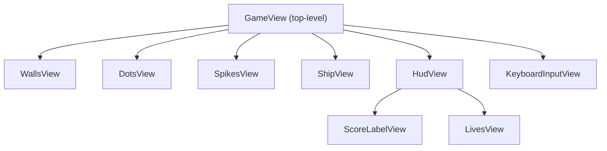

# Composing Views

> A game's view is a tree of views. A parent view builds its children, wires
> each one's bindings to the model, and puts them in its container, and each
> child can read only its own bindings. Any number of views can read the same
> model, and you add one without touching the others. Values that many
> views share travel by import or by binding, never by a lookup that a
> view's bindings don't show. And the view tree is shaped by what's on
> screen, so it doesn't have to match the model's tree.

**Related:** [Models](04-models.md) · [Views](07-views.md) ·
[Bindings](08-bindings.md) ·
[Writing Views in JSX](12-writing-views-in-jsx.md) ·
[Lists and Switches](14-lists-and-switches.md)

Here's the top-level view of a small grid game. It shows the grid's walls,
dots and spikes, the player's ship and a HUD, and it turns the arrow keys
into actions on the player's model:

```tsx
function GameView(bindings: GameViewBindings): Container {
    const { model } = bindings;
    const { grid } = model;
    return (
        <container>
            <container y={HUD_HEIGHT}>
                <WallsView
                    rows={grid.rows}
                    cols={grid.cols}
                    isWallAt={(row, col) => grid.tileKindAt(row, col) === 'wall'}
                />
                <DotsView
                    rows={grid.rows}
                    cols={grid.cols}
                    hasDotAt={(row, col) => grid.tileKindAt(row, col) === 'dot'}
                />
                <SpikesView
                    rows={grid.rows}
                    cols={grid.cols}
                    hasSpikeAt={(row, col) => grid.tileKindAt(row, col) === 'spike'}
                />
                <ShipView
                    row={() => model.player.row}
                    col={() => model.player.col}
                />
            </container>
            <HudView
                score={() => model.score}
                lives={() => model.lives}
            />
            <KeyboardInputView
                onDirectionPressed={(dir) => model.player.turnTo(dir)}
            />
        </container>
    );
}
```

The grid is drawn by three views, one for each layer, stacked in the order
they're drawn: the walls, then the dots on top, then the spikes. Each one
draws one thing, and reads one value for each cell.

`GameView` references the model. Its children don't. `DotsView` reads only
the number of rows and columns, and whether each cell has a dot. The grid
model has one kind of tile for each cell, so the wiring turns that into
the value that each layer reads. `HudView` reads a score and a number of
lives. The children don't reference the player or the grid model, and
their bindings don't show that the score and the lives come from the same
place. This is why you can test `HudView` with `score: () => 1200`, and
reuse it in the next game.

## Parent Views Wire Their Children

A parent view builds each child, wires its bindings as
[Chapter 8](08-bindings.md#wiring-bindings) showed, and adds it to its own
container. In a tree of views, it matters where that wiring sits.

The top-level view takes the model itself as its main binding, as
[Chapter 8](08-bindings.md#when-to-pass-the-whole-model) explains, because
it belongs to one game and will never be reused. Anything from outside
the model, such as a player's setting, comes in beside it. Every view
below it takes query bindings for what it shows and relay bindings for the
input it reports. So the wiring, the place
where `model.score` meets `score`, is all in the parents, and mostly in
the top-level view.

A tree like this one is typical:



`HudView` is a parent too. It takes `score` and `lives`, and passes each one
on to the child that shows it. A middle view like this wires its children
from its own bindings, rather than from the model, so it stays as reusable
as they are.

[§](#try-composed-grid-game) is that game, built from exactly this tree.
All the wiring is in `game-view.tsx`. Then open `hud-view.tsx`, which
passes its two bindings on to its children. Steer with the arrow keys.

The buttons on the left, or the keys 1 to 5, hide and show each of
`GameView`'s children. That's the one thing the experiment adds to the
listing: each child sits in a container with a `visible` getter, and
`main.ts` keeps which ones are hidden. The game carries on underneath,
because hiding a view doesn't change anything in the model. Switch the
walls, the dots and the spikes off one at a time, and you'll
see the grid come apart into its layers: the game's view is a stack of
small views, each drawing one thing. Then hide the dots, collect a few,
and show them again. The ones you took are gone on the first frame back,
because the dots view reads the model rather than storing what happened
while it was hidden.

<TryIt example="composed-grid-game" file="views/game-view.tsx" />

`GameView` is written in JSX, where each child is a tag. A parent with a
plain TypeScript body makes the same calls, as the `GameView` in
[Chapter 8](08-bindings.md#wiring-bindings) does, and its children can't
tell the difference.

A parent builds its children once, and never forwards their update or
refresh calls. `updateView` and `refreshView` reach every view in the
tree, as
[Chapter 7](07-views.md#updating-and-refreshing-views-with-the-mvtjs-libraries)
showed, so a child takes part just by setting its steps.

## Many Views of One Model

Every view reads the same models, so any number of them can show the same
state. Take a game's phase, which two views read:

```tsx
<GridView phase={() => model.phase} /* ... */ />
<OverlayView phase={() => model.phase} /* ... */ />
```

The grid rebuilds its tiles when a new level starts. The overlay shows
"Game Over" when the game ends. Both read `model.phase`, and they don't
reference each other. One doesn't send the other an event, and they don't
both set a flag.

They can't disagree, either. Every model finishes its update before any
view refreshes, so on any one frame, every view reads the same phase.
[Chapter 5](05-the-tick.md) explains why that holds.

That makes adding a view easy. Say you want a minimap. You write
`MinimapView`, give it bindings that read the grid and the player, and add
it to `GameView`. The other views don't change, and the models don't
change either, unless the minimap reads state that the model doesn't yet
expose. The new view is up to date on its first frame, because it reads
the same state that every other view does.

[§](#try-composed-grid-game-minimap) is the grid game with that minimap
added. It took one new file, `minimap-view.tsx`, and one new tag in
`GameView`. Steer the ship, and watch the dots go from the grid and the
minimap together. Then press 1, 2 and 3 to hide the walls, the dots and
the spikes: the minimap carries on alone, because it never read the
grid's views, only the model.

<TryIt example="composed-grid-game-minimap" file="views/minimap-view.tsx" />

## Children That Come and Go

Some children can't be built once. Asteroids split, bullets are fired and
expire, enemies arrive in waves. A parent has one child per object, and
the set of objects changes every few frames.

[Chapter 14](14-lists-and-switches.md), next, introduces `<List>`, which
keeps one child view for each position in a collection, and reuses it for
whatever item is in that position. You can also manage the children by
hand. Watch the count with a [reaction](09-noticing-changes.md), and
rebuild the children only when it changes:

```ts
const rebuildAsteroidViewsWhenCountChanges = createReaction({
    watch: () => model.asteroids.length,
    react: () => rebuildAsteroidViews(),
});
// A reaction never reacts to its first read, so build the first views now
rebuildAsteroidViews();

function refresh(): void {
    rebuildAsteroidViewsWhenCountChanges();
}
```

This is more code, and it destroys and builds views each time the count
changes, which `<List>` avoids. It's worth it when there are only a few
children, they change rarely, and you'd rather see every step.

## Sharing Values Between Many Views

Views deep in the tree often read the same values: a palette, a text
style, the size of a tile. Passing them down as bindings means every view
in between takes a binding it doesn't use, only to pass it on. Three
levels down, that's three bindings types that say "this view reads a
palette" when it doesn't.

In most games, the answer is to import them from a module of constants:

```ts
import { LABEL_STYLE, TILE_SIZE } from './view-constants';
```

This suits views that belong to one game. Each value has one home, so
changing a colour there changes it in every view that uses it.

Imports have a drawback, though. An imported value isn't in the view's
bindings, so a caller or a test can't pass the view a different one. That
matters for two kinds of value. One is a value that varies, such as a
palette that the player picks. The other is any value that a reused view
reads, such as the colours of a HUD panel that several games share, where
each game has its own colours.

When a view is reused, keep the values it reads in its bindings, so its
bindings type lists everything it depends on and each caller supplies its
own. Three habits keep the extra code for passing values down small:

- **Pass a built child.** A view that only places a child can take it
  ready-made, and never read the child's bindings. A panel that frames a
  minimap doesn't need to reference what the minimap reads:
  `<PanelView title="Map" content={<MinimapView ... />} />`.
- **Group values that travel together.** One `theme` binding, holding a
  palette, text styles and a number formatter, adds one line to each level
  rather than three.
- **Make related views in one function.** A factory such as
  `createHudViews({ palette })` returns views that close over the palette,
  so it's supplied once for the whole group. Their own bindings no longer
  show it, so keep this for views that are always used together.

Some UI frameworks also let a view look up a value from whichever ancestor
provides one. React and Solid call this *context*. The `@mvtjs` JSX
runtimes don't have context, and that's a choice, not a gap. Values travel
by import or by binding, so everything a view depends on stays visible: in
its imports, or in its bindings type. A value found by context would be a
dependency that the imports and the bindings type both hide, and a
missing one would fail only when the view runs, far from the code that
didn't provide it.

## A View Tree Shaped by the Screen, Not the Model Tree

In a simple game, the two trees look alike. A ball model has a ball view, a
paddle model has a paddle view, and the views sit side by side just as the
models do. That's fine, but it's a coincidence of a simple game, not a
rule. As games grow, the two trees diverge:

- **Many views of one model.** One game model might be read by a grid view,
  a HUD, an overlay and a minimap.
- **Views without a model.** A scrolling background, particles and screen
  transitions are all presentation, and the models don't have anything
  that matches them.
- **Models without a view.** A collision system or an enemy's planner is
  never drawn. You see its effects through the models that views do read.
- **Different groupings.** A model might hold one flat list of enemies,
  while the views split them into layers, so that flying enemies draw over
  the ground. Or a model might nest its children deeply, while one view
  reads the state it shows through a few bindings.

Bindings let the trees differ. A view reads state through its bindings,
not by walking the model, so its place in the view tree doesn't depend on
where that state sits in the model tree. You shape the
models around the game's rules ([Chapter 4](04-models.md)), and the views
around what's on screen.

## Common Mistakes

### A middle view that passes on a value it never uses

A middle view's bindings include a `palette` it only passes on to its
children. The value is being threaded down the tree to the views that
use it. Import the palette in the views that use it, if they belong to
one game, or pass the middle view a built child, so the palette never
passes through it.

### A view tree that copies the model tree

Your view tree has a view for every model, even models that don't have
anything to show, and the backdrop and the transitions don't have an
obvious home. The
views were shaped to mirror the models. Start from what's on screen
instead.

### A view that runs twice, or never

An animation runs at double speed, or a view deep in the tree never moves.
A parent view is calling its children's steps by hand, so they run once
from the walk and once from the parent, or a parent that's meant to pass
the tick on to its children skips one of them. In this book, never call a child's
`update` or `refresh` yourself. Set each view's steps on its own
container, and let `updateView` and `refreshView` reach it.

## Summary

A parent view builds its children, wires their bindings, and adds them to
its container, once. The top-level view reads the model, and passes each
child only what it shows, so the children stay reusable and easy to test.
Many views can read the same state, and they always agree, so adding a view
never means changing another one. Children that come and go are a
`<List>`, which Chapter 14 covers.

Values that many views share come from a module of constants when the views
belong to one game, and through bindings when a view is reused, with a
built child, a `theme` or a factory to keep the extra code small. The
`@mvtjs` JSX runtimes don't have context, so everything a view depends on
shows in its imports or its bindings. And since views read through
bindings, the view tree can follow the screen rather than the model.
