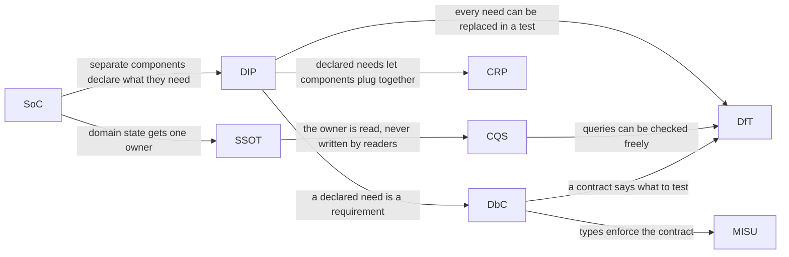

# The Principles Behind MVT

> Each of MVT's rules follows from a small set of well-known design
> principles, and all eight serve one goal: you can understand, test and
> change any part of a game without touching the rest. This chapter
> introduces the eight, and shows how each builds on the ones before it.
> The chapters after it take one principle each, and the last chapter of
> the book uses them to settle a request that the rules don't cover. Learn
> the reasons, and you can decide the new cases yourself.

**Related:** [MVT on One Page](../appendices/a-mvt-on-one-page.md) ·
[Single Source of Truth (SSOT)](27-single-source-of-truth.md) ·
[Using the Principles](34-using-the-principles.md)

A designer plays your game and asks for one small thing: *the screen
should shake when the player is hit.* You check the rules in
[Appendix A](../appendices/a-mvt-on-one-page.md). They tell you that a
[model](../appendices/b-glossary.md) advances only through
`update(deltaMs)`, and that a [view](../appendices/b-glossary.md) doesn't
hold domain state. The rules don't mention screen shake.

So where does the shake go? Does the model need to track it? How does the
view detect that the player was hit, when the hit is over before the view
ever runs? The rules can't say, because they were written before anyone
thought of this case. By the end of this part, you'll be able to answer
each question, and say why.

## Why Principles, Not Just Rules

Rules say what an MVT program must do. They're quick to check, and most of
the time they're all you need.

Sooner or later, though, you meet a case that the rules don't mention.
Perhaps a view plays sounds instead of drawing, or needs to detect that the
player was just hit, or two games share a model. Then it helps to know
*why* the rules exist, because the same reasons apply to the new case.

A principle is the reasoning behind a group of rules, put generally enough
to cover cases that the rules never anticipated. The eight in
this chapter are decades-old ideas, each with a name you can search for.
MVT applies all of them, together, to a program that runs in frames.

## The Goal

A [component](../appendices/b-glossary.md), here and in the chapters
that follow, is any separable unit of an MVT program: a model, a view, the
ticker. Where that could be unclear, the text says *MVT component*, or
names the kind. Every principle here serves one goal:

> **Any component of a game can be understood and tested alone, and changed
> or replaced without changing anything else.**

This is easiest to see from its opposite. In a tangled program, a change
ripples. Renaming a field breaks a view. The fix to the view changes what
its parent passes in, and that changes what a test expects. Each step is
small, but you can't tell in advance where the ripple stops. So every
change takes more work than it should, and is riskier than it looks.

The goal is for the ripple to stop at the edge of the component you
changed. The rest of the game isn't affected. You don't need to edit
anything else, or check anything else again. Each
principle below is one way of stopping the ripple.

## The Eight Principles

They're best read in this order, since each builds on the ones before it.
The chapters after this one cite them by their short names, such as SSOT,
so the table gives each one's full name and its acronym together.

| # | Principle | In one line | Its question |
| --- | --- | --- | --- |
| 1 | [Separation of Concerns (SoC)](26-separation-of-concerns.md) | Domain state, presentation and time are separate concerns, with separate owners: the model, the view and the ticker | Which concern does this belong to? |
| 2 | [Single Source of Truth (SSOT)](27-single-source-of-truth.md) | Each piece of domain state lives in one place; everything else reads it or derives it | Where does this value really live? |
| 3 | [Command-Query Separation (CQS)](28-command-query-separation.md) | Reading state never changes it: each tick runs every command, then every query | Does this read change anything? |
| 4 | [Dependency Inversion Principle (DIP)](29-dependency-inversion.md) | A component declares what it needs, as a small interface, and receives it, time included | Is this component reaching for something it should receive? |
| 5 | [Composite Reuse Principle (CRP)](30-composite-reuse.md) | Build bigger things by combining smaller ones, never by extending them | Can this be built from components that already exist? |
| 6 | [Design by Contract (DbC)](31-design-by-contract.md) | Every component states what it requires and what it guarantees, and fails loudly when a requirement isn't met or a guarantee can't be kept | What does this need, and what exactly does it guarantee? |
| 7 | [Make Illegal States Unrepresentable (MISU)](32-make-illegal-states-unrepresentable.md) | Design state and types so that illegal states can't even be written | Can this be set to an illegal state? |
| 8 | [Design for Testability (DfT)](33-design-for-testability.md) | Every component can be tested on its own, through its contract, with the same result every time | How would I test this, with nothing real around it? |

Each of the next eight chapters takes one principle. In each, you'll find
where the idea came from, the symptoms of breaking it, what it means for
MVT, its benefits and drawbacks, the ways people misread it, a checklist,
and the rules that follow from it.

## How the Principles Build on One Another

The principles aren't a checklist of separate ideas. Each one makes the
next possible, or makes it worth using.

Separating the concerns puts domain state in models, with one home for
each piece. Reading it without changing it means every view reads the
same state, in any order, sixty times a second. Passing each component
what it depends on lets components combine, a stated contract makes
combining them safe, and the types enforce the contract where they can.
Testing each component alone, with nothing real around it, proves the
rest.

## Summary

Rules cover the cases someone thought of. Principles cover the rest,
because they say why the rules exist. MVT rests on eight well-known
principles, and each serves the same goal: a change to one component stops
at its edge.

- **SoC** gives domain state, presentation and time separate owners.
- **SSOT** gives each piece of domain state one home, and **CQS** makes
  reading it safe from anywhere, in any order.
- **DIP** passes each component what it depends on, which lets **CRP**
  build big components from small ones.
- **DbC** states what each component requires and guarantees, and **MISU**
  lets the types enforce those guarantees.
- **DfT** follows from all of them: each component can be tested alone.

The next eight chapters take one principle each, in this order. Then
[Chapter 34](34-using-the-principles.md) comes back to the screen shake.

## Further Reading

Each principle's chapter ends with its original sources.
