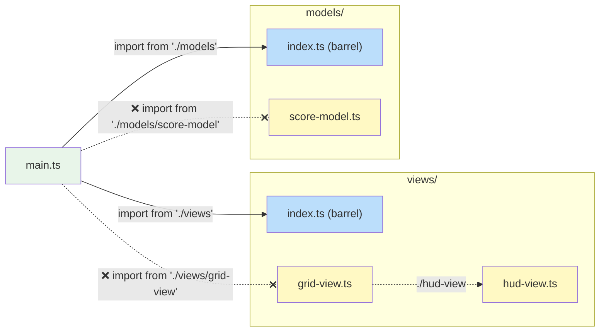

# Project Structure

> Directory layout, module conventions, and barrel file rules for this
> codebase. These are organisational choices specific to this project, not
> MVT architectural requirements.

**Related:** [Style Guide](style-guide.md) · [Architecture Rules](architecture-rules.md)

---

## Directory Layout

The repository is an npm workspace. It has five libraries: four published
under the `@mvtjs` npm scope, and the sound chips, published as `audio90`.
The visual testing package is published as `v-snap`. Its other packages are private: the lint rules, the Arcade, the
playground, the docs, the benchmarks and the checks.

```
packages/
├── libraries/           What people build with
│   ├── utils/           @mvtjs/utils: renderer-agnostic helpers (the view tick API, watch, SlotList, tweens, metronome, performance meter); JSX base at ./jsx
│   ├── pixi/            @mvtjs/pixi: the view tick API for Pixi containers, performance metrics, and Pixi's JSX runtime
│   ├── three/           @mvtjs/three: the view tick API for three.js objects, pointer picker, and its JSX runtime
│   ├── html/            @mvtjs/html: the view tick API for DOM elements, its JSX runtime, and a Perfmon view
│   └── audio90/         audio90, on npm: the Audio80 and Audio90 sound chips, their tracker notation and music player; guides in docs/
├── tools/               What people use while developing
│   ├── v-snap/          v-snap, on npm: visual snapshot tests for canvas and HTML views, as Vitest projects
│   └── eslint-plugin/   @mvtjs/eslint-plugin (private): this repo's lint rules
├── sites/               What gets deployed
│   ├── arcade/          @mvtjs/arcade (private): the Arcade, its games and demos (Vite), and the Cloudflare Worker that keeps the highscore tables
│   ├── playground/      @mvtjs/playground (private): an editor in the browser that runs small MVT projects in a sandbox (Vite)
│   └── docs/            @mvtjs/docs (private): this documentation (VitePress)
└── tests/               What tests the other packages, and never ships
    ├── benchmarks/      @mvtjs/benchmarks (private): performance benchmarks, for the libraries and the games alike
    └── checks/          @mvtjs/checks (private): tests that the packages still fit together as decided
notes/                   Proposals and tasks
```

The packages are grouped by what each one is for, not by whether it is
published, so that publishing one moves nothing.

Each package's source is in its own `src/`. The site's is laid out by area:

```
packages/sites/arcade/src/
├── arcade/              The Arcade, the home page, in HTML JSX: model, views, its own sounds, and the page's loop (main.ts)
├── entries/             Every game and demo, one directory each, and catalogue.ts, which lists them
│   └── <id>/            Self-contained entry
│       ├── start/       How the Arcade lists the entry, and loads it
│       ├── data/        Static data and configuration constants
│       ├── models/      State and domain logic + domain types
│       └── views/       Presentation and user-input handling
├── device/              What the visitor's device supports, such as touch
├── input/               Input that needs no renderer: the keyboard, for the entry host and the Pixi stage
├── entry-types/         What an entry is: ArcadeEntry, its tags, the starters and sessions
├── highscores/          The highscore tables' rules, and the page's stores. The Worker that keeps the tables is in ../highscores-worker/
├── runner/              The entry host, which runs one entry of any renderer in the MVT order, and the page's sound
├── pixel-glyphs/        The site's pixel glyphs: every printable ASCII character as rows of cells, which entries draw their own way, imported as `#pixel-glyphs`
├── shared/              The site's shared views (overlay, pixel text, input, swipes), imported as `#shared`
├── tunes/               The site's Audio90 tunes, their instruments and samples, which the Tune Tracker plays, imported as `#tunes`
└── storage/             What the site keeps in the visitor's browser between visits: settings, favourites, saved games
```

The playground is laid out by what each part does. Its examples and
starting projects are real files, linted and type-checked as the rest are:

```
packages/sites/playground/
├── src/
│   ├── models/          The workspace and its layout: the files, the run, the problems, the dialogs open
│   ├── views/           The page's views, in HTML JSX, the editor's extensions, and the themes
│   ├── language/        The TypeScript language service, in a worker: completions, types, problems, barrels
│   ├── runtime/         Making a project ready to run: transpiling, loop guards, imports, the sandbox's page, links
│   ├── sandbox/         What runs in the sandbox: the runner, and a host for each renderer
│   ├── export/          A project as a Vite project of its own, zipped
│   ├── storage/         The projects and settings kept in the visitor's browser
│   ├── examples/        Reads the examples and the starting projects, as text
│   ├── project-api/     The `playground` module a project imports: the define functions
│   └── main.ts          The page's loop
├── examples/<id>/       The examples, each a project
├── starters/<renderer>/ The projects New starts from, one for each renderer
├── libraries/           What a project may import, and a module for each
└── scripts/             Vite plugins: the type bundles, and the versions an export depends on
```

[Visual tests](../building-with-mvt/iterating-with-confidence/visual-tests.md)
are in a `visual-tests/` directory beside the views they test, one
`<view>.test.tsx` file for each view. Each test file's reference images
are beside it, named for the file's stem and the image, such as
`hud-view.at-the-start.png`. The tests come from v-snap, the package in `packages/tools/v-snap/`. The
root `vitest.config.ts` lists v-snap's projects beside the unit tests, and
the Arcade's `vsnap.config.ts` registers the kinds of view that the tests
pose, which it refreshes and destroys the MVT way. v-snap's
[README](https://github.com/yortus/mvt-games/blob/main/packages/tools/v-snap/README.md)
describes the package for its users, and its
[CONTRIBUTING.md](https://github.com/yortus/mvt-games/blob/main/packages/tools/v-snap/CONTRIBUTING.md)
describes how it is laid out, tested and published.

Every directory under a package's `src/` is a **module** with a specific
responsibility. Each module has a barrel file (`index.ts`) that defines its
public API.

| Directory | Contains                                                  | Typical Exports                                           |
| --------- | --------------------------------------------------------- | --------------------------------------------------------- |
| `data/`   | Constants, configuration, static datasets                 | Data objects, lookup tables                               |
| `models/` | Model interfaces, options types, factory functions, domain types | `ScoreModel`, `createScoreModel`, `Direction`, `TileKind` |
| `views/`  | View functions, bindings interfaces                       | `HudView`, `HudViewBindings`                              |
| `packages/libraries/utils/src/` | Renderer-agnostic helpers and models          | `watch`, `memoiseLast`, `createSlotList`, `createSequence`, `createMetronome`, `assert` |
| `packages/sites/arcade/src/shared/` | The site's shared views                          | `OverlayView`, `PixelTextView`, `KeyboardInputView`, `SwipeInputView` |
| `packages/sites/arcade/src/storage/` | What the site keeps in the browser between visits | `LocalStore`, `createLocalStore`, `createMemoryStore` |

::: info Data directories are not MVT layers
Game modules typically include a `data/` directory for static constants (arena
dimensions, speeds, timing values). This is a practical organisational choice,
not an MVT architectural layer. MVT has three layers: model, view, and ticker.
:::

## Barrel Files

Every directory under a package's `src/` provides a barrel file (`index.ts`)
that defines its public API. This is the backbone of the project's module
system. Between packages, a package's `exports` field plays the same part:
other packages import `@mvtjs/pixi` or `@mvtjs/utils/jsx`, never a file inside
it.

### Why Barrel Files Matter

Barrel files solve four problems that arise as a codebase scales:

1. **Clear module boundaries.** The barrel is the only entry point into a
   directory. Consumers import from the barrel, never from internal files.
   This makes the boundary between "public API" and "implementation detail"
   explicit and checkable.

2. **Internal structure hiding.** Files inside a module can be renamed, split,
   merged, or reorganised without breaking any consumer. Only the barrel's
   re-exports are the contract. Today's single-file helper can become a
   multi-file directory tomorrow - the barrel absorbs the change.

3. **Smooth scaling from files to directories.** A module can start life as a
   single `.ts` file. When it grows, it becomes a directory with an
   `index.ts` barrel. Consumer import paths stay the same (`'./models'`
   resolves to either `models.ts` or `models/index.ts`). This low friction
   encourages splitting at the right time rather than too late.

4. **Circular reference avoidance.** With barrels as the only cross-module
   entry point, dependency cycles are easier to spot and prevent. The rules
   below (no declarations in barrels, no self-imports) eliminate the most
   common source of accidental cycles.

This is enforced by ESLint: `@mvtjs/no-deep-imports` for reaching past
a barrel, and `no-restricted-imports` for the self-imports below.

### Import Rules

- All imports from **outside** a directory must go through the barrel - never
  reach past it into individual files.
- Imports **within** the same directory use direct relative paths (`./foo`).
- **Never include `.ts` extensions** in module specifiers - write `'./foo'`,
  not `'./foo.ts'`. The importer should not know or care whether a module
  resolves to a file or a directory (this supports smooth scaling).



```ts
// ✅ Correct - importing from the barrel
import { createScoreModel } from './models';
import type { Direction } from '../models';

// ❌ Wrong - reaching past the barrel into a specific file
import { createScoreModel } from './models/score-model';
import type { Direction } from '../models/common';
```

### Barrel File Contents

Barrel files contain **only re-exports** - no declarations, no logic, no side
effects.

```ts
// index.ts - ✅ correct: re-exports only
export { createCounterModel } from './counter-model';
export type { CounterModel, CounterModelOptions } from './counter-model';
export { createTimerModel } from './timer-model';
export type { TimerModel } from './timer-model';
```

```ts
// index.ts - ❌ wrong: barrel contains a declaration
export function createScoreModel(): ScoreModel {
    /* ... */
}
export { createHelperModel } from './helper-model';
```

Move declarations into their own file and re-export them:

```ts
// score-model.ts        ← declaration lives here
export function createScoreModel(): ScoreModel {
    /* ... */
}

// index.ts              ← barrel re-exports it
export { createScoreModel } from './score-model';
```

**Why no declarations in barrels?**

- **Locatability** - every directory has an `index.ts`, so definitions there
  are hard to find. A dedicated file gives the definition a clear, searchable
  name.
- **Cyclic-import safety** - when a barrel both declares code and re-exports
  sibling modules, those siblings may try to import the barrel-declared
  symbol, creating a cycle. Keeping barrels declaration-free eliminates this
  risk.

### No Self-Imports Through the Barrel

Files inside a directory must **never** import from their own barrel. Always
use direct relative paths to the sibling file:

```ts
// Inside models/score-model.ts

// ✅ Correct - direct relative import to sibling
import { type Direction } from './common';

// ❌ Wrong - importing from own barrel creates a cycle
import { type Direction } from '.'; // resolves to ./index.ts
import { type Direction } from './index'; // same problem, explicit
```

This applies at **any** depth, not just to files sitting directly beside the
barrel. A file in a subdirectory is still inside the module, so reaching up to
an ancestor barrel is the same violation:

```ts
// Inside models/helpers/clamp.ts

// ❌ Wrong - ancestor barrel, still a self-import
import { type Direction } from '..';
import { type Direction } from '../index';

// ✅ Correct - the ancestor's file, directly
import { type Direction } from '../common';
```

A file in a subdirectory is inside its ancestors' modules, so it imports what
it needs from them as a sibling would: the file directly. The JSX support
under each renderer does this (`packages/libraries/html/src/jsx/` imports
`'../element-mixin'`). Another module's public API is reached through its
barrel, never past it.

Importing from your own barrel creates a circular dependency: the barrel
re-exports you, and you import from the barrel. Even when the cycle is
technically resolvable, it makes the dependency graph harder to reason about
and can cause runtime issues where an imported value is `undefined` because
the exporting module has not finished initializing.

## Between Packages

The rules above apply inside each package. Between packages:

- **Import a package by name**: `@mvtjs/pixi` or `@mvtjs/utils/jsx`, never a
  path into it. Its `exports` field lists what can be reached, as a barrel
  does for a directory. Inside the repo these names resolve to the package's
  `src/`, through an `@mvtjs/source` export condition that TypeScript, Vite,
  Vitest and the benchmarks all set, so nothing needs building first.
- **Declare what you import.** Every import names a dependency of the nearest
  `package.json`. npm hoists packages to the root `node_modules`, so an
  undeclared import still works here, then fails for whoever installs the
  package. ESLint's `import/no-extraneous-dependencies` reports it. Tests,
  scripts and config files may import `devDependencies`; other code may not.
- **Import the view tick API from your renderer package.** Each renderer
  package re-exports the names it shares with `@mvtjs/utils`: `updateView`,
  `refreshView`, `setUpdate`, `setRefresh`, `SKIP_DESCENDANTS`, `hasUpdate`,
  `hasRefresh`, the tick counter, and the method types. It re-exports
  `advanceTime` too, a separate helper for tests. The site and the
  benchmarks import them from the renderer they use, so each name has one
  place to come from, and the import also loads the renderer, which
  registers its views (`no-restricted-imports`). They are the same functions
  in every renderer package, so code that uses two renderers imports them
  from either.
  `@mvtjs/utils` is imported directly for its helpers: `watch`, tweens,
  sequences, slot lists, the metronome.
- **The playground stands alone.** It is a package of its own,
  `packages/sites/playground/`, and shares no code with the Arcade. It
  imports only the libraries, as the projects it runs do.

Within the site, its shared views are imported as `#shared`, the tunes
two of its demos play as `#tunes`, and the pixel glyphs that entries set
their text in as `#pixel-glyphs`. Each is an alias that
`packages/sites/arcade/package.json` defines.

## Entry Structure

Each game and demo is an **entry**: a self-contained module under
`packages/sites/arcade/src/entries/<id>/`, named for its id. A typical layout:

```
packages/sites/arcade/src/entries/<id>/
├── index.ts              Barrel - re-exports the entry
├── start/
│   ├── index.ts          Barrel - re-exports `entry` from entry.ts
│   ├── entry.ts          `entry`: what the Arcade's card shows (name, tags, thumbnail...), `loadDetails` and `load`
│   ├── details.ts        `details`: the long text (description, how it's made, instructions, techniques), loaded after the first paint
│   ├── load.ts           `load()`: the entry's code, imported only when it is launched
│   ├── thumbnail.webp    Its card's picture, made by `npm run generate-thumbnails`
│   └── share.png         Its link preview's picture, made by the same script
├── data/
│   ├── index.ts          Barrel - re-exports shared game constants
│   └── constants.ts      Shared game constants (used by both models and views)
├── models/
│   ├── index.ts          Barrel - re-exports all models, types, and model constants
│   ├── model-constants.ts  Model-only constants (physics, scoring, timing)
│   ├── common.ts         Domain types (directions, kinds of game object, phases)
│   └── game-model.ts     Root model - composes all child models
└── views/
    ├── index.ts           Barrel - re-exports GameView and view constants
    ├── view-constants.ts  View-only constants (pixel sizes, HUD layout)
    └── game-view.ts       Top-level view - wires all child views (.tsx if its body is JSX)
```

`start/` is the same in every entry, so the Arcade, the thumbnail script and
the benchmarks find each one the same way. Everything else is the entry's
own: a small demo may have only `models/` and `views/`.

For details on creating a new entry, see
`packages/sites/arcade/src/entries/README.md` in the repository.
