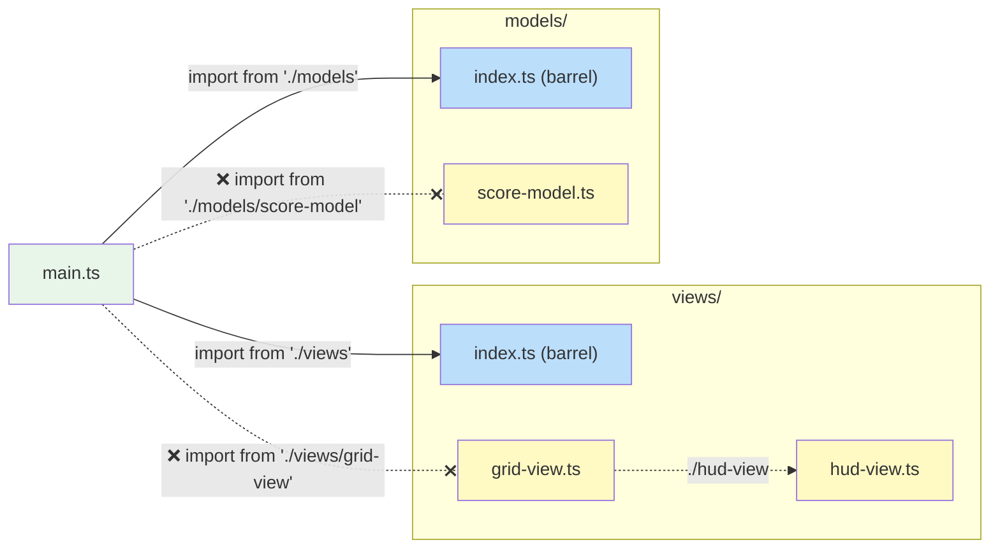

# Project Structure

> This page shows where things live in this repo, and the rules for
> importing between them. Every directory is a module with one way in, its
> barrel file, so you can reorganise a module's insides without breaking
> anything outside it. These choices belong to this repo, not to MVT.

**Related:** [Code Style](code-style.md) ·
[MVT on One Page](../appendices/a-mvt-on-one-page.md) ·
[Writing Guide](writing-guide.md)

---

## Directory Layout

The repository is an npm workspace. Six of its packages are published to
npm: four libraries under the `@mvtjs` scope, the sound chips as
`audio90`, and the visual testing package as `v-snap`. The rest are
private: the three sites and their kit, the playground, the docs, the lint rules, the
benchmarks and the checks.

```
packages/
├── libraries/           What is published to npm
│   ├── utils/           @mvtjs/utils: renderer-agnostic helpers (the view tick API, watch, reactions and computed values, SlotList, tweens, metronome, performance meter); JSX base at ./jsx
│   ├── pixi/            @mvtjs/pixi: the view tick API for Pixi containers, performance metrics, and Pixi's JSX runtime
│   ├── three/           @mvtjs/three: the view tick API for three.js objects, pointer picker, and its JSX runtime
│   ├── html/            @mvtjs/html: the view tick API for DOM elements, its JSX runtime, and a Perfmon view
│   ├── audio90/         audio90, on npm: the Audio80 and Audio90 sound chips, their tracker notation and sequencer; guides in docs/
│   └── v-snap/          v-snap, on npm: visual snapshot tests for canvas and HTML views, as Vitest projects
├── sites/               What gets deployed
│   ├── arcade/          @mvtjs/arcade (private): the Arcade, the arcade games' site (Vite)
│   ├── demos/           @mvtjs/demos (private): the Demos' site (Vite)
│   ├── puzzles/         @mvtjs/puzzles (private): the Puzzles' site (Vite)
│   ├── site-kit/        @mvtjs/site-kit (private): what the three sites share, and the Cloudflare Worker that keeps the highscore tables
│   ├── playground/      @mvtjs/playground (private): an editor in the browser that runs small MVT projects in a sandbox (Vite): src/, examples/, book/ and starters/ (each a project; book/ holds the examples the book's pages run, starters/ are what New opens), libraries/ (what a project may import), cheat-sheets/ (the cheat sheets, beside the editor, in the embeds and in Appendix G)
│   └── docs/            @mvtjs/docs (private): the book, and the pages for working in this repo (VitePress)
└── internal/            What serves this repo only, and never ships
    ├── eslint-plugin/   @mvtjs/eslint-plugin (private): this repo's lint rules, loaded from source by `eslint.config.ts`
    ├── benchmarks/      @mvtjs/benchmarks (private): performance benchmarks, for the libraries and the games
    └── checks/          @mvtjs/checks (private): tests that the packages still fit together as decided
notes/                   Proposals and tasks
```

The packages are grouped by whether they ship, since that decides the rules
that a package follows. Each package in `libraries/` is published to npm, so it
records its changes for its changelog, and its docs are written for its own
users. Each one in `sites/` is deployed, and each one in `internal/` serves
only this repo. If a package in `internal/` is ever published, it moves to
`libraries/`.

Each package's source is in its own `src/`. There are three sites, the
arcade (its games), the demos and the puzzles, and each is the same small
package: its page, a note of what it is (`site.ts`), and its entries:

```
packages/sites/<site>/
├── index.html           The site's page. The site kit writes its nav in
├── vite.config.ts       defineSiteConfig({ site }), from @mvtjs/site-kit/vite
└── src/
    ├── main.ts          startSitePage(SITE): runs the page
    ├── site.ts          SITE: its name, its marquee, its catalogue, and whether its entries are games or demos
    └── entries/         Its entries, one directory each, and catalogue.ts, which lists them
        └── <id>/        Self-contained entry
            ├── start/   How the site lists the entry, and loads it
            ├── data/    Static data and configuration constants
            ├── models/  State and domain logic, and the domain types
            └── views/   Presentation and user-input handling
```

Everything the sites share is in the site kit, `packages/sites/site-kit/`,
laid out by area. A site imports each folder by its package name, as
`@mvtjs/site-kit/shared`:

```
packages/sites/site-kit/src/
├── arcade/              The page each site runs, in HTML JSX: model, views, its own sounds, its styles, and the page's loop (start-site-page.ts)
├── device/              What the visitor's device supports, such as touch
├── input/               Input that doesn't need a renderer: the arcade controls the entry host creates for a game, the keyboard, taps and drags over a grid, taps and holds on keys, pans and zooms, and a pointer followed over a DOM element
│   └── pixi/            Input on a Pixi stage: a pointer followed over a container, a button that shows its hold, and the touch, swipe and drag views
├── entry-types/         What an entry is: ArcadeEntry, its tags, the starters and sessions
├── highscores/          The highscore tables' rules, and the page's stores. The Worker that keeps the tables is in ../highscores-worker/
├── runner/              The entry host, which runs one entry of any renderer in the MVT order, and the page's sound
├── pixel-glyphs/        The pixel glyphs: every printable ASCII character as rows of cells, which entries draw their own way
├── random/              The seeded random source models take: the same seed always gives the same sequence
├── shared/              The Pixi views entries share: the overlay and pixel text
├── sound/               The chip types views play on
├── snapshot/            The page `generate-thumbnails` photographs each entry on
├── testing/             The checks every site's catalogue passes
└── storage/             What the site keeps in the visitor's browser between visits: settings, favourites, saved games
```

The playground is laid out by what each part does. Its examples and
starting projects are real files, linted and type-checked as the rest are:

```
packages/sites/playground/
├── src/
│   ├── models/          The workspace and its layout: the files, the run, the problems, the dialogs open
│   ├── views/           The page's views, in HTML JSX, the editor's extensions, and the themes
│   ├── language/        The TypeScript language service, in a worker: completions, types, problems, barrels
│   ├── runtime/         Making a project ready to run: transpiling, loop guards, imports, the sandbox's page, links
│   ├── sandbox/         What runs in the sandbox: the runner, and a host for each renderer
│   ├── export/          A project as a Vite project of its own, zipped
│   ├── storage/         The projects and settings kept in the visitor's browser
│   ├── examples/        Reads the examples and the starting projects, as text
│   ├── project-api/     The `playground` module a project imports: the define functions
│   └── main.ts          The page's loop
├── examples/<id>/       The examples, each a project
├── starters/<renderer>/ The projects New starts from, one for each renderer
├── libraries/           What a project may import, and a module for each
└── scripts/             Vite plugins: the type bundles, and the versions an export depends on
```

The docs hold the book, *Building Web Games with MVT*, and the pages for
working in this repo. The site's sidebar lists them in the order that
`.vitepress/book.ts` sets:

```
packages/sites/docs/
├── index.md              The book's preface
├── chapters/             The chapters, one file each, numbered in reading order
├── appendices/           The lettered appendices, then one for each principle
├── working-in-this-repo/ Code style, project structure, and the Writing Guide
├── ai-agents/            The skills an AI agent loads before a task (not published)
├── articles/             Drafts of essays (not published)
├── public/               Files served as they are, such as llms.txt
└── .vitepress/           The site's config, and book.ts, the reading order
```

[Visual tests](../chapters/17-visual-tests.md)
are in a `visual-tests/` directory beside the views they test, one
`<view>.test.tsx` file for each view. Each test file's reference images
are beside it, named for the file's stem and the image, such as
`hud-view.at-the-start.png`. The tests come from v-snap, the package in
`packages/libraries/v-snap/`. The root `vitest.config.ts` lists v-snap's
projects beside the unit tests, and
each site's `vsnap.config.ts` registers the kinds of view that the tests
pose, which it refreshes and destroys the MVT way. v-snap's
[README](https://github.com/yortus/mvt-games/blob/main/packages/libraries/v-snap/README.md)
describes the package for its users, and its
[CONTRIBUTING.md](https://github.com/yortus/mvt-games/blob/main/packages/libraries/v-snap/CONTRIBUTING.md)
describes how it is laid out, tested and published.

Unit tests sit beside the code they test, named for its file, such as
`score-model.test.ts`, and run in Node. They're the check you run while
working, so they're kept fast: each one has a budget of 2 seconds, set as
its timeout in the root `vitest.config.ts`, and most take a few
milliseconds. A test that needs longer, such as one that type-checks a
whole program, starts every game, or searches every case of a puzzle,
goes in a `*.slow.test.ts` file instead, usually beside a unit test that
checks a sample. `npm run test:slow` runs those, and CI runs them on every
push. The unit tests that run in plain Node share their workers' modules,
which takes the run from about 20 seconds to 12, so such a file must leave
no global state changed for the files after it. CI runs them in a shuffled
order to catch one that does. A file that runs in a page, which names
`happy-dom` in its first comment, gets a fresh worker of its own, since a
page carries too much over: an open dialog, a listener on the window. So
does a file that counts on a module's state from a fresh start, listed in
`ISOLATED_TESTS` in the root `vitest.config.ts`, with why.

Every directory under a package's `src/` is a **module** with a specific
responsibility. Each module has a barrel file (`index.ts`) that defines its
public API.

| Directory | Contains                                                  | Typical Exports                                           |
| --------- | --------------------------------------------------------- | --------------------------------------------------------- |
| `data/`   | Constants, configuration, static datasets                 | Data objects, lookup tables                               |
| `models/` | Model interfaces, options types, factory functions, domain types | `ScoreModel`, `createScoreModel`, `Direction`, `TileKind` |
| `views/`  | View functions, bindings interfaces                       | `HudView`, `HudViewBindings`                              |
| `packages/libraries/utils/src/` | Renderer-agnostic helpers and models          | `watch`, `createReaction`, `createComputed`, `createSlotList`, `createSequence`, `createMetronome`, `assert` |
| `packages/sites/site-kit/src/shared/` | The site's shared views                          | `OverlayView`, `PixelTextView` |
| `packages/sites/site-kit/src/input/pixi/` | Input on a Pixi stage                  | `listenToPointer`, `listenToPress`, `SwipeInputView`, `DragInputView`, `TouchInputView` |
| `packages/sites/site-kit/src/storage/` | What the site keeps in the browser between visits | `LocalStore`, `createLocalStore`, `createMemoryStore` |

::: info Data directories are not MVT layers
Game modules typically include a `data/` directory for static constants (arena
dimensions, speeds, timing values). This is a practical organisational choice,
not an MVT architectural layer. MVT has three layers: model, view, and ticker.
:::

## Barrel Files

Every directory under a package's `src/` has a barrel file (`index.ts`)
that lists what the directory exports to the rest of the code. Code outside
the directory imports only from the barrel. Between packages, a package's
`exports` field plays the same part: other packages import `@mvtjs/pixi`
or `@mvtjs/utils/jsx`, never a file inside it.

### Why Barrel Files Matter

Barrels become more useful as a codebase grows, in four ways:

1. **Each module has a clear boundary.** The barrel is the only way into a
   directory. What it exports is the module's public API, and everything
   else is a detail of how the module works. Lint can check that imports
   never reach past it.
2. **You can reorganise a module freely.** You can rename, split or merge
   the files inside it without breaking any code that uses it, because
   only the barrel's exports are the contract.
3. **A file can grow into a directory.** A module can start as a single
   `.ts` file, and become a directory with an `index.ts` when it grows.
   The import paths stay the same, since `'./models'` finds either
   `models.ts` or `models/index.ts`. Splitting is easy, so you can do it
   when it's due rather than too late.
4. **Import cycles are rarer.** When barrels are the only way between
   modules, a cycle is easier to spot. The rules below keep declarations
   out of barrels, and forbid importing your own barrel. Together, they
   prevent the most common accidental cycles.

ESLint checks these rules. `@mvtjs/no-deep-imports` reports an import
that reaches past a barrel, and `no-restricted-imports` reports a file
that imports its own barrel.

### Import Rules

- **From outside a directory, import through its barrel.** Never reach
  past it into one of its files.
- **Within a directory, import the file directly,** with a relative path
  such as `'./foo'`.
- **Leave out the `.ts` extension.** Write `'./foo'`, not `'./foo.ts'`.
  The import then reads the same whether the module is a file or a
  directory, so a file can grow into a directory without any import
  changing.



```ts
// ✅ Correct - importing from the barrel
import { createScoreModel } from './models';
import type { Direction } from '../models';

// ❌ Wrong - reaching past the barrel into a specific file
import { createScoreModel } from './models/score-model';
import type { Direction } from '../models/common';
```

### Barrel File Contents

A barrel file holds only re-exports. It doesn't hold any declarations,
logic or side effects.

```ts
// index.ts - ✅ correct: re-exports only
export { createCounterModel } from './counter-model';
export type { CounterModel, CounterModelOptions } from './counter-model';
export { createTimerModel } from './timer-model';
export type { TimerModel } from './timer-model';
```

```ts
// index.ts - ❌ wrong: barrel contains a declaration
export function createScoreModel(): ScoreModel {
    /* ... */
}
export { createHelperModel } from './helper-model';
```

Move declarations into their own file and re-export them:

```ts
// score-model.ts        ← declaration lives here
export function createScoreModel(): ScoreModel {
    /* ... */
}

// index.ts              ← barrel re-exports it
export { createScoreModel } from './score-model';
```

There are two reasons. Every directory has an `index.ts`, so a definition
in one is hard to find, while a file of its own gives it a name you can
search for. And when a barrel both declares something and re-exports its
siblings, a sibling that needs the declaration has to import the barrel,
which makes a cycle. A barrel that holds only re-exports can't cause one.

### Never Import Your Own Barrel

A file inside a directory never imports from its own barrel. It imports
the sibling file directly:

```ts
// Inside models/score-model.ts

// ✅ Correct - direct relative import to sibling
import { type Direction } from './common';

// ❌ Wrong - importing from own barrel creates a cycle
import { type Direction } from '.'; // resolves to ./index.ts
import { type Direction } from './index'; // same problem, explicit
```

This holds at any depth, not only for the files beside the barrel. A file
in a subdirectory is still inside the module, so importing an ancestor's
barrel is the same mistake:

```ts
// Inside models/helpers/clamp.ts

// ❌ Wrong - ancestor barrel, still a self-import
import { type Direction } from '..';
import { type Direction } from '../index';

// ✅ Correct - the ancestor's file, directly
import { type Direction } from '../common';
```

A file in a subdirectory is inside its ancestors' modules, so it imports what
it needs from them as a sibling would: the file directly. The JSX support
under each renderer does this (`packages/libraries/html/src/jsx/` imports
`'../element-mixin'`). Another module's public API is reached through its
barrel, never past it.

Importing your own barrel makes a cycle: the barrel re-exports your file,
and your file imports the barrel. Even when JavaScript can resolve the
cycle, it makes the imports harder to follow. It can also fail at run
time, when a value you import is still `undefined` because the module that
exports it hasn't finished loading.

## Between Packages

The rules above apply inside each package. Between packages:

- **Import a package by name**: `@mvtjs/pixi` or `@mvtjs/utils/jsx`, never a
  path into it. Its `exports` field lists what can be reached, as a barrel
  does for a directory. Inside the repo these names resolve to the package's
  `src/`, through an `@mvtjs/source` export condition that TypeScript, Vite,
  Vitest and the benchmarks all set, so nothing needs building first.
- **Declare what you import.** Every import names a dependency of the nearest
  `package.json`. npm hoists packages to the root `node_modules`, so an
  undeclared import still works here, then fails for whoever installs the
  package. ESLint's `import/no-extraneous-dependencies` reports it. Tests,
  scripts and config files may import `devDependencies`; other code may not.
- **Import the view tick API from your renderer package.** Each renderer
  package re-exports the names it shares with `@mvtjs/utils`: `updateView`,
  `refreshView`, `setUpdate`, `setRefresh`, `SKIP_DESCENDANTS`, `hasUpdate`,
  `hasRefresh`, the tick counter, and the method types. It re-exports
  `advanceTime` too, a separate helper for tests. The site and the
  benchmarks import them from the renderer they use, so each name has one
  place to come from, and the import also loads the renderer, which
  registers its views (`no-restricted-imports`). They are the same functions
  in every renderer package, so code that uses two renderers imports them
  from either.
  `@mvtjs/utils` is imported directly for its helpers: `watch`, tweens,
  sequences, slot lists, the metronome.
- **The playground stands alone.** It is a package of its own,
  `packages/sites/playground/`, and doesn't share any code with the
  sites. It imports only the libraries, as the projects it runs do.

The sites import the kit by its name: its shared views as
`@mvtjs/site-kit/shared`, and the pixel glyphs that entries set their text
in as `@mvtjs/site-kit/pixel-glyphs`. Inside the kit, they are aliases
(`#shared`, `#pixel-glyphs`, `#input/pixi`) that its `package.json` defines.
What needs a renderer sits in a folder named for it, inside the area it
belongs to, such as `input/pixi/`, so a folder the page imports before its
first paint loads no renderer. The demos
keep the tunes two of them play as `#tunes`. Sudoku's puzzle maker and grid
are in Sudoku's own folder, in the puzzles, and Sudoku Digger, a demo that
shows the maker at work, imports them as `@mvtjs/puzzles/sudoku-generator`.
The demos may import from the puzzles, and never the other way round. Every
puzzle on the puzzles site is a puzzle a day, and they share
`packages/sites/puzzles/src/shared/`: the days' numbers, the records of what
is solved and started, the calendar to choose a day from, and the way in.
The way in is a card that says how to play, and a walkthrough on a practice
puzzle, with an arrow that shows each step. Each comes as models and views.

## Entry Structure

Each game, demo and puzzle is an **entry**, a self-contained module under
`packages/sites/<site>/src/entries/<id>/`, named for its id. Here's a
typical layout:

```
packages/sites/<site>/src/entries/<id>/
├── index.ts              Barrel - re-exports the entry
├── start/
│   ├── index.ts          Barrel - re-exports `entry` from entry.ts
│   ├── entry.ts          `entry`: what its card shows (name, tags, thumbnail...), `loadDetails` and `load`
│   ├── details.ts        `details`: the long text (description, how it's made, instructions, techniques), loaded after the first paint
│   ├── load.ts           `load()`: the entry's code, imported only when it is launched
│   ├── thumbnail.webp    Its card's picture, made by `npm run generate-thumbnails`
│   └── share.png         Its link preview's picture, made by the same script
├── assets/               Sprite images, drawn by its `generate-<id>-textures.ts` script, if it has one
├── data/
│   ├── index.ts          Barrel - re-exports shared game constants
│   └── constants.ts      Shared game constants (used by both models and views)
├── models/
│   ├── index.ts          Barrel - re-exports all models, types, and model constants
│   ├── model-constants.ts  Model-only constants (physics, scoring, timing)
│   ├── common.ts         Domain types (directions, kinds of game object, phases)
│   └── game-model.ts     Root model - composes all child models
└── views/
    ├── index.ts           Barrel - re-exports GameView and view constants
    ├── view-constants.ts  View-only constants (pixel sizes, HUD layout)
    └── game-view.ts       Top-level view - wires all child views (.tsx if its body is JSX)
```

`start/` is the same in every entry, so the sites, the thumbnail script and
the benchmarks find each one the same way. Everything else is the entry's
own: a small demo may have only `models/` and `views/`. The top-level model
and view are always easy to find: `game-model.ts` and `game-view.ts` in a game
or a puzzle, and `demo-model.ts` and `demo-view.ts` in a demo.

To add an entry, follow
[Adding an Entry](https://github.com/yortus/mvt-games/blob/main/packages/sites/arcade/src/entries/README.md),
the README in `packages/sites/arcade/src/entries/`.
