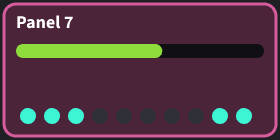
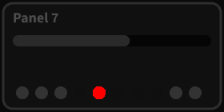

<p align="center">
  
</p>

<h1 align="center">v-snap</h1>

<p align="center">
  <strong>Visual tests as fast and as dependable as unit tests.</strong><br>
  For views drawn with Pixi, three.js, any canvas, or HTML.
</p>

<p align="center">
  
  
  
  
  
</p>

`v-snap` makes visual testing as convenient as unit testing. A visual test
builds a view in a known state, renders it to an image, and compares that
image with a reference image, which is an accepted image committed beside
the test file. It is a kind of snapshot test, also known as a visual
regression test. v-snap runs on Vitest's browser mode, so visual tests are
Vitest tests.

The package is `v-snap`, which a project installs and imports. Its code
says `vsnap`, as names can't hold a hyphen: `vsnap()`, `defineVsnapConfig`,
and the file `vsnap.config.ts`.

## Why v-snap

- **Fast.** A canvas image takes about 4 ms to draw and check, 17 times
  less than a screenshot test in the same browser. 1000 images run in under
  8 seconds, start-up included.
- **The same images on every machine.** Windows, Linux and macOS draw the
  same images, so a reference made on one passes on the others. arm64
  processors round some drawing by a level or two, which a small tolerance
  covers. v-snap is checked on Windows x64, Linux x64 and arm64, and macOS
  arm64.
- **No Docker, no setup.** `npm ci` installs everything but the browser,
  which the first run downloads.
- **Tests read like unit tests.** One line declares one image, and a new
  test needs no other change. There is no test page to build.
- **Pixi, three.js, any canvas, and HTML.** v-snap draws Pixi and three.js
  views itself, and support for another renderer is a small object. HTML
  views are tested too.
- **Vitest's tools work.** Watch mode reruns a test when its view changes.
  The Vitest UI shows a failed image beside its reference, and the VS Code
  extension lists and runs the tests.

## What It Gives Up

The images are the same everywhere because v-snap decides how they are
drawn. That has costs, which [Limits and Rules](docs/limits-and-rules.md)
lists in full:

- **Canvas text is drawn in v-snap's own fonts.** A view's font is
  replaced with Source Sans 3 or Source Code Pro, by its font list. Text that a
  view measures, to wrap or fit it, is measured in those fonts, and a
  character that they lack, such as ★, an emoji or a Chinese character, is
  drawn as a box.
- **HTML text is drawn blank.** Each letter keeps its width but draws
  nothing, so an HTML image shows layout and styling, not words. A change
  to the text's colour or weight doesn't show.
- **Drawing is done in software.** WebGL runs on the processor, so
  whatever a graphics card would draw differently isn't tested.
- **One browser build.** Each release of v-snap is checked against the
  build of Chromium that one Playwright version names, so a project
  installs that version of Playwright.

## How Fast?

The same 1000 images of Pixi views, checked with v-snap and with Vitest's
own `toMatchScreenshot`, in the same browser:

| | 1000 images, start-up included | One image, at the median |
| --- | ---: | ---: |
| **v-snap**, in one page | **7.8 s** | **4.0 ms** |
| `toMatchScreenshot`, in one page | 89.9 s (11.5x) | 67 ms (17x) |
| `toMatchScreenshot`, 13 pages at once | 18.0 s (2.3x) | 131 ms (33x) |

Like for like, in one browser page each, v-snap runs the whole suite 11.5
times as fast, and each image 17 times as fast. By default, Vitest opens a
page for each processor core but one, and runs that many test files at
once. On the 14-core laptop measured, that is 13 pages, which share the
processor, so each screenshot takes longer. Even then, v-snap in one page
is 2.3 times as fast. A machine with fewer cores, such as a CI runner,
runs fewer pages at once, so there the gap should be wider.

[The benchmark](docs/how-it-works.md#the-benchmark) says how it was
measured, and how to run it.

## A Taste

A test file sits in a `visual-tests` folder beside its view. Each test
gives a name, and a pose: a function that returns the view in the state
that the test describes.

```tsx
// src/hud/visual-tests/hud-view.test.tsx
import { canvasTest } from 'v-snap';
import { HudView } from '../hud-view';

canvasTest('at the start', () => HudView({ score: () => 0 }));
canvasTest('a high score', () => HudView({ score: () => 98_765 }));
```

The first run writes each image as its test's reference, beside the test
file, as `hud-view.at-the-start.png` and `hud-view.a-high-score.png`. Look
at them, and commit them. From then on, each run compares the images with
them.

## When an Image Changes

A test whose image changed fails, and v-snap writes its actual image and a
diff. The diff shows the reference dimmed, and the pixels that changed in
red. Here, one more light is on:

| The reference | The actual image | The diff |
| :---: | :---: | :---: |
|  |  |  |

The failure message says where the image changed, and by how much:

```
Image 'a-panel' differs from its reference in 214 pixels, by up to 194 of 255,
in the 16x16 pixels at (116, 108).
```

It goes on to name the three files, and ends with the command that
accepts the change: `vitest run <file> -u`. The Vitest UI shows the same
three images, with a slider between the reference and the actual image.

## Quick Start

1. Install v-snap beside Vitest. npm also installs Playwright and Vitest's
   Playwright provider, which v-snap needs.

   ```sh
   npm install --save-dev v-snap vitest
   ```

2. List v-snap's projects in `vitest.config.ts`, after a project for the
   unit tests, which leaves out the visual tests.

   ```ts
   import { configDefaults, defineConfig } from 'vitest/config';
   import { vsnap } from 'v-snap/vitest';

   export default defineConfig({
       test: {
           projects: [
               {
                   extends: true,
                   test: {
                       name: 'unit',
                       exclude: [...configDefaults.exclude, '**/visual-tests/**'],
                   },
               },
               ...vsnap(),
           ],
       },
   });
   ```

3. Register the kinds of view that the tests pose in `vsnap.config.ts`,
   beside it, and add the file to `tsconfig.json`'s `include`.

   ```ts
   import { defineVsnapConfig } from 'v-snap';
   import { pixiViews } from 'v-snap/pixi';

   const config = defineVsnapConfig({ views: [pixiViews()], defaultKind: 'pixi' });

   // Gives canvasTest's types the kinds of view above, and the default kind.
   declare module 'v-snap' {
       interface Register {
           config: typeof config;
       }
   }

   export default config;
   ```

4. Add `.vitest/` to `.gitignore`. v-snap writes a failed test's images
   there.

5. Write a test, as above, and run `npx vitest`.

[Getting Started](docs/getting-started.md) covers a project whose config
already has settings, and what v-snap needs.

## Documentation

- **[Getting Started](docs/getting-started.md)**: the requirements, adding
  v-snap to a project, and the first test.
- **[Writing Tests](docs/writing-tests.md)**: declaring tests, views that
  change over time, options, tables of cases, image names, and how HTML
  views are captured.
- **[Kinds of View](docs/kinds-of-view.md)**: Pixi, three.js, canvases and
  HTML, the options of each, preparing and disposing of views, configs in
  a monorepo, and support for another renderer.
- **[Configuration](docs/configuration.md)**: `vsnap()`'s options, what
  its projects inherit, and where test files and references go.
- **[Running the Tests](docs/running-tests.md)**: the commands, the checks
  of the references, the summary, reviewing a failed image, CI and watch
  mode.
- **[How It Works](docs/how-it-works.md)**: what makes v-snap fast, the
  benchmark, and how it gives the same images on every machine.
- **[Limits and Rules](docs/limits-and-rules.md)**: what the images leave
  out, and the rules that tests follow.
- **[Troubleshooting](docs/troubleshooting.md)**: v-snap's messages, and
  what they usually mean.

## API

| Import | Export | What it is |
| --- | --- | --- |
| `v-snap` | `canvasTest(name, options?, pose)` | Declares a test of a view drawn on a canvas. It has Vitest's modifiers, such as `.skip`, `.only` and `.each` |
| | `htmlTest(name, options?, pose)` | Declares a test of an HTML view, with the same modifiers |
| | `defineVsnapConfig(config)` | Returns the config that `vsnap.config.ts` exports, with its kinds of view and its default kind |
| | `bindCanvasTest(config)` | Returns a `canvasTest` whose types know one config's kinds of view, for a monorepo's packages |
| | `htmlViews(options?)` | Returns the kind for HTML views, with steps to prepare and dispose of them, and a background for every test |
| | `fitImage`, `readCanvas` | Helpers for support for another renderer: how an image fits the size budget, and a canvas's pixels |
| `v-snap/vitest` | `vsnap(options?)` | Returns the Vitest projects that run the visual tests, to list in `test.projects` |
| `v-snap/pixi` | `pixiViews(options?)` | Returns the kind for Pixi views |
| `v-snap/three` | `threeViews(options?)` | Returns the kind for three.js views |

## Requirements

| Needs | Version |
| --- | --- |
| Vitest, with `@vitest/browser-playwright` | 5 |
| Playwright, installed with v-snap | 1.63, any patch release |
| Node | 22.17 or later |
| Pixi, for Pixi views | 8.16 or later |
| three.js, for three.js views | 0.160 or later |

A canvas test can draw with the browser's own canvas, and needs no
renderer library. [Getting Started](docs/getting-started.md#requirements)
says why each is needed.

## Contributing

To work on v-snap itself, see [CONTRIBUTING.md](./CONTRIBUTING.md). It says
how v-snap's own tests run, how the package is laid out, how the test
environment is checked and upgraded, and how the package is built and
published.

## Licence

MIT. The fonts in `src/browser/fonts/` are under the SIL Open Font
License, whose text is beside them.
